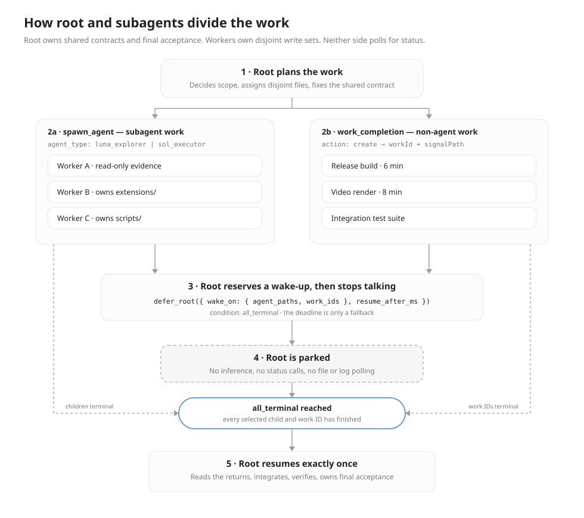
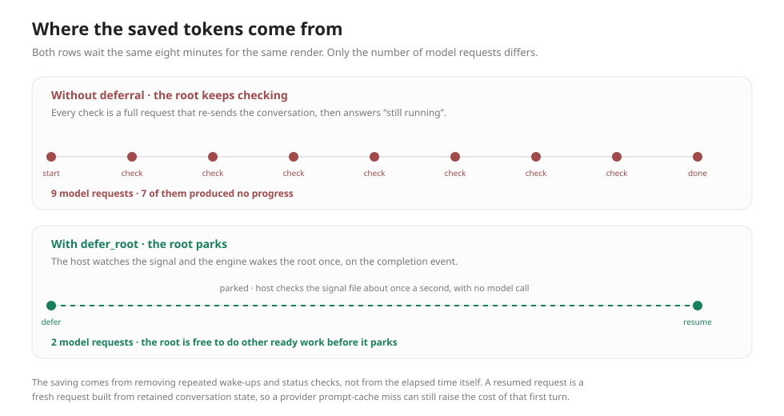
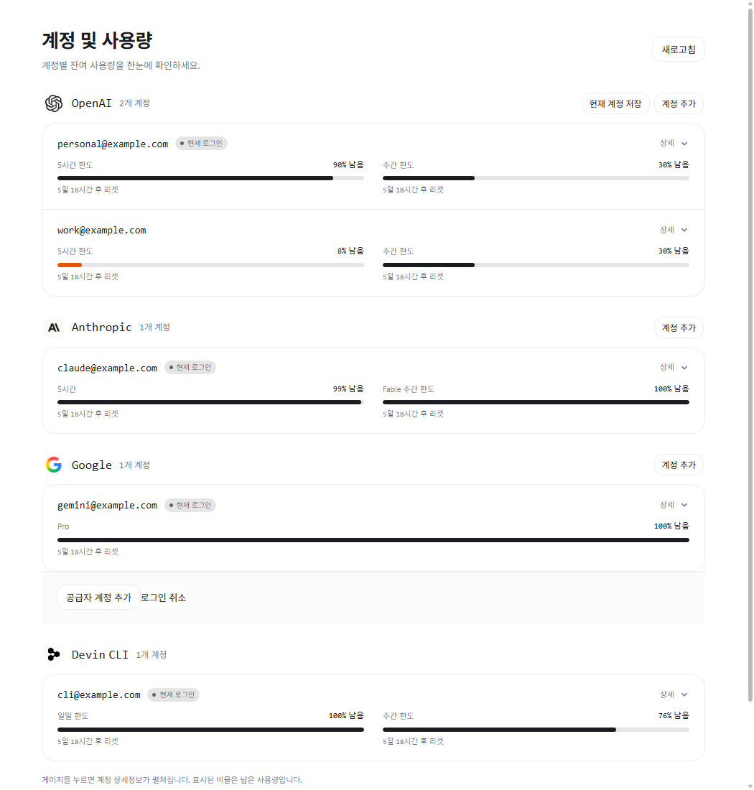
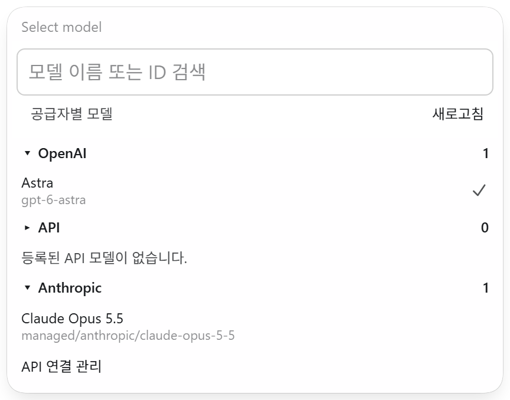
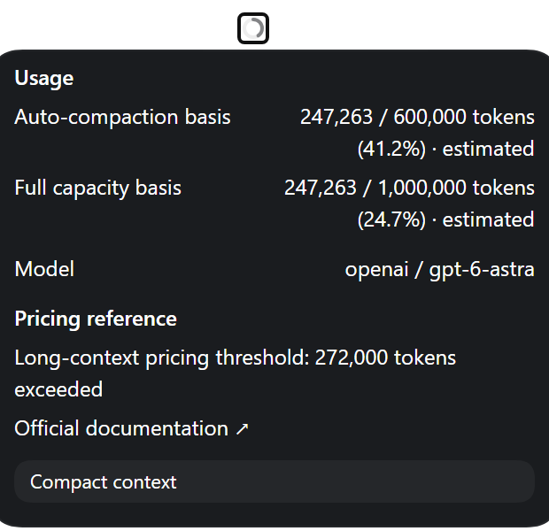
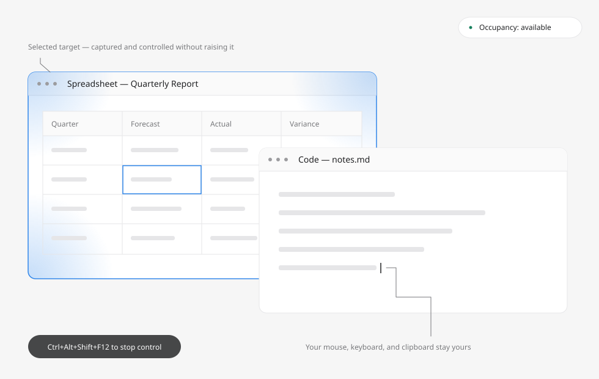
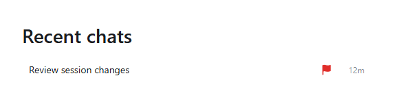

# Azrael

[English](README.md) | **한국어**

Azrael은 VS Code에서 AI 에이전트와 함께 코드와 프로젝트 작업을 하기 위한 독립 호스트입니다. Codex 기반 엔진과 UI 위에, 길고 여러 에이전트가 참여하는 작업에 실제로 필요한 기능을 더했습니다. 범위가 정해진 서브에이전트를 조정하는 루트 에이전트, 빌드와 렌더링이 진행되는 동안 루트가 토큰을 쓰지 않고 기다리는 재개 예약, 하나의 선택기로 모이는 여러 계정과 제공자, 대기열에 넣는 컨텍스트 압축, 같은 데스크톱에서 에이전트와 나란히 일하는 Window Use, 중요한 대화로 빠르게 돌아가는 플래그가 그 예입니다.

Azrael은 하나의 통합 확장으로 실행됩니다. 계정·대화·설정은 일반 Codex와 분리된 `~/.azrael-ex`에 보관하며, 설치 과정은 기존 Codex 확장과 다른 확장, VS Code 설정을 보존합니다.

> [!NOTE]
> Azrael은 개발 중이며 기능마다 검증된 범위가 다릅니다. 이 문서는 각 기능 옆에 그 한계를 함께 적었고, 정식 기준은 [아키텍처 문서](docs/architecture/README.md)입니다.

## 목차

- [주요 기능](#주요-기능)
- [에이전트 협업 방식](#에이전트-협업-방식)
- [사람이 쓰기 편한 작업 환경](#사람이-쓰기-편한-작업-환경)
- [Window Use](#window-use-에이전트와-나란히-작업하기)
- [세션 플래그](#세션-플래그)
- [플랫폼 지원](#플랫폼-지원)
- [설치](#설치)
- [사용법](#사용법)
- [개발](#개발)
- [라이선스와 출처](#라이선스와-출처)

## 주요 기능

| 기능 | 제공하는 것 |
| --- | --- |
| **루트·서브에이전트 협업** | 루트 에이전트 하나가 결정과 최종 수용을 맡고, 작업자는 파일 단위로 좁게 배정받아 병렬로 실행합니다. |
| **루트 재개 예약** | 선택한 서브에이전트와 빌드·렌더링 같은 외부 작업이 끝날 때까지 루트가 대기하며, 모델 요청으로 상태를 반복 확인하지 않습니다. |
| **계정 및 사용량** | 제공자마다 여러 계정을 연결하고, 남은 사용량과 초기화 시각을 보며 한 번의 클릭으로 전환합니다. |
| **여러 제공자의 모델** | OpenAI, Devin, Anthropic, Google, xAI, OpenRouter와 직접 등록한 API를 검색 가능한 하나의 선택기에서 고르고, 대화 중에도 바꿉니다. |
| **컨텍스트 압축** | 모델별 자동 압축 기준과, 실행 중인 턴을 끊지 않고 대기열에 넣는 수동 압축을 제공합니다. |
| **Window Use** *(실험적)* | 에이전트가 선택한 창 하나를 관찰·조작하는 동안 마우스·키보드·클립보드는 사용자가 계속 사용합니다. |
| **세션 플래그** | 대화에 빨간 깃발을 꽂아 Chats 목록에서 눈에 띄게 합니다. |
| **복구와 대기열** | 대기 중인 입력은 창을 다시 로드해도 유지되고, 이미 접수된 턴은 재전송하지 않고 대조합니다. |

이 문서의 UI 화면은 프로젝트의 개발용 렌더링 도구로 Azrael의 실제 컴포넌트를 렌더링해 캡처했습니다. 화면 속 계정·대화·사용량·모델 목록은 모두 **합성 데이터**이며 개인 계정이나 세션을 열지 않았습니다. 협업·토큰·Window Use 그림은 설명용 일러스트입니다. [이미지 출처와 재현 방법](docs/images/README.md)을 참고하세요.

## 에이전트 협업 방식

### 두 가지 역할, 결과의 책임자는 하나

Azrael은 **루트 에이전트**에 네이티브 조정 지침을 제공하고(프로젝트 `AGENTS.md`에 복사하지 않고 엔진과 함께 유지합니다), **서브에이전트**는 의도적으로 좁게 유지합니다.

| | 루트 에이전트 | 서브에이전트(작업자) |
| --- | --- | --- |
| **책임** | 요구사항, 범위, 공유 인터페이스, 쓰기 범위 배정, 실행 순서, 통합과 최종 수용 | 배정받은 결과 하나와 넘겨받은 파일 |
| **받는 것** | 사용자 요청과 프로젝트 지침 | 인계 항목: *Objective, Scope, Constraints, References, Done when, Return format* |
| **재위임** | 가능 | 불가 — 자식은 다시 위임하지 않습니다 |
| **보고** | 모든 완료 기준과 정리가 끝난 뒤 사용자에게 | 실제 수행 범위, 종료 코드, 로그 경로, 검증하지 못한 항목 |

함께 배포하는 지침 라이브러리는 두 가지 작업자 역할을 정의하며, 역할마다 모델을 따로 지정해 가벼운 작업은 가볍게 처리합니다.

- **`luna_explorer`** — 지정된 파일·디렉터리 안에서 근거를 읽기 전용으로 수집합니다. 수정, 빌드, 아키텍처 결정은 하지 않습니다.
- **`sol_executor`** — 동작과 범위가 확정된 뒤의 구현과 검증을 맡으며, 배정받은 파일만 수정합니다.

인계에는 대화 전체 대신 결정 사항과 정확한 경로를 전달하고, 새 자식은 부모의 대화 기록 없이 시작합니다. 사용자가 등록한 API 모델과 Devin 모델을 포함해 다른 제공자의 지원 모델도 서브에이전트로 실행할 수 있으며, 각자 별도의 스레드와 계정 연결을 갖습니다.

### 비용 없이 기다리기: `defer_root`

긴 작업을 감독할 때 비싼 부분은 대개 작업 자체가 아니라 기다림입니다. "빌드 끝났어?"를 반복해서 묻는 루트는 매번 대화 전체를 다시 보내는 모델 요청 비용을 내고, 대답은 거의 언제나 "아직"입니다.

Azrael은 이 반복을 루트 전용 도구 **`azrael_agents.defer_root`**로 대체합니다.

- 루트는 기다릴 대상을 지정합니다. `wake_on.agent_paths`(서브에이전트)와 `wake_on.work_ids`(외부 작업)를 `condition: all_terminal`로 지정하고, 대비용 마감 시각(최대 12시간의 `resume_after_ms` 또는 UTC `resume_at`)을 함께 둡니다.
- 예약을 영속 저장한 뒤 루트는 **대기 상태**가 됩니다. 추론도, 상태 호출도, 파일·로그 폴링도 하지 않습니다. 서브에이전트는 그대로 계속 실행됩니다.
- 선택한 모든 대상이 종료 상태(성공, 실패, 취소)에 이르거나 마감 시각이 되면, 둘 중 먼저 오는 시점에 엔진이 루트를 **한 번** 깨웁니다. 일반 진행 메시지는 저장되지만 루트를 깨우지 않습니다.

### 외부 작업의 종료 플래그

빌드, 렌더링, 테스트 묶음은 서브에이전트가 아니므로 Azrael은 이들을 위한 종료 플래그 **`azrael_agents.work_completion`**을 제공합니다.

1. 루트가 `action: create`로 `work_completion`을 호출해 `workId`와 스레드 소유의 `signalPath`를 받습니다.
2. 작업이 끝날 때 실제 결과를 그 경로에 게시하도록 작업을 시작합니다. 예를 들어 함께 제공하는 도구를 사용할 수 있습니다.

   ```sh
   node scripts/complete-work.cjs --signal-path <signalPath> --state succeeded --exit-code 0 --summary "render finished"
   ```

3. `wake_on.work_ids: [workId]`로 대기합니다. 대기하는 동안 **호스트**가 약 1초마다 신호 파일을 확인하며, 모델 호출은 일어나지 않습니다.
4. 재개되면 루트는 이후 작업을 진행하기 전에 기록된 상태를 먼저 읽습니다. 종료 결과는 변경할 수 없으며, 타이머나 수동 재개는 완료로 간주하지 않습니다.



예를 들어 루트가 8분짜리 영상 렌더링을 시작하고, 서브에이전트에게 릴리스 노트를 맡기고, 자신의 독립 수정을 끝낸 다음 두 작업을 기다립니다. 렌더링이 도는 동안에는 비용이 들지 않고, 루트는 한 번 깨어나 결과를 확인하고 통합합니다.

대기 중인 예약은 **루트 재개 예약** 화면에 사유, 로컬 재개 시각, 기다리는 자식 목록과 함께 표시되며, 바로 재개와 취소 동작을 제공합니다. 채팅에는 기다리는 서브에이전트의 아바타가 네이티브 재개 동작 옆에 나타나고, 턴 경과 시간은 대기 시점에서 멈춥니다. 예약을 취소해도 서브에이전트나 외부 작업은 취소되지 않습니다.

> **적용 범위.** `defer_root`는 검증된 네이티브 도구 전송 경로를 가진 제공자에만 노출되며, 현재는 **네이티브 OpenAI 루트 경로**입니다. 외부 작업 신호는 Windows 네이티브 소스에서 검증되었고, 설치 패키지와 다른 플랫폼의 수용은 별도 단계입니다. 다른 제공자의 일반 서브에이전트 협업에는 이 도구가 포함되지 않습니다. 자동 재개에는 루트가 로드된 상태로 엔진이 실행 중이어야 합니다.

### 전체 작업이 더 빠르고 가벼운 이유



- **기본이 병렬입니다.** 독립 작업은 순서대로 기다리지 않고 겹쳐 실행되며, 루트는 전체 완료 시간을 좌우하는 작업부터 시작합니다.
- **중복 작업이 없습니다.** 쓰기 범위를 겹치지 않게 나눠 충돌하는 수정을 피하고, 이미 실행 중인 빌드를 하나 더 시작하지 않습니다.
- **요청이 작습니다.** 작업자는 부모의 대화 대신 참조와 결정 사항을 받고, 읽기 전용 탐색은 더 가벼운 모델로 실행합니다.
- **놀면서 폴링하지 않습니다.** 대기 중인 루트는 추론하지 않습니다. 절감은 반복적인 깨우기와 상태 확인을 없애는 데서 오며, 경과 시간 자체에서 오지 **않습니다**.
- **데스크톱 작업의 왕복이 적습니다.** Window Use 작업 매크로는 클릭마다 모델 턴을 쓰는 대신 최대 32개의 기계적 단계를 도구 호출 한 번으로 실행합니다.

그림은 요청 횟수를 설명하기 위한 것이며 측정한 벤치마크가 아닙니다. 재개된 턴은 보존된 대화 상태로 만드는 새 요청이므로, 제공자의 프롬프트 캐시가 적중하지 않으면 입력 비용이 늘어날 수 있습니다. 캐시를 유지하려고 짧은 타이머를 반복하기보다, 적절한 대비 마감 시각과 함께 완료 시점에 깨어나도록 하는 편이 좋습니다.

자세한 내용: [루트 조정](docs/architecture/root-coordination.md), [루트 재개 예약](docs/architecture/root-resume.md), [지침 라이브러리](instructions/README.md).

## 사람이 쓰기 편한 작업 환경

### 여러 계정을 한 화면에서

프로필 메뉴에서 **계정 및 사용량**을 엽니다. 모든 제공자의 계정이 제공자 로고 아래에 묶여 한곳에 표시되고, 계정마다 남은 사용량 게이지와 초기화 시각, 현재 사용 중인 계정의 배지가 나타납니다.



- **한 번의 클릭으로 전환합니다.** 계정마다 한 번만 로그인해 두면, 사용량이 줄어들거나 프로젝트가 바뀔 때 바로 옮겨갈 수 있습니다.
- **창마다 독립적입니다.** VS Code 창마다 다른 창이 쓰는 계정을 포함해 어떤 계정이든 선택할 수 있습니다.
- **제공자별로 기억합니다.** 대화는 제공자마다 사용한 계정을 기억하므로, OpenAI → Anthropic → OpenAI로 오가도 같은 OpenAI 계정으로 돌아옵니다.
- **자동 전환을 선택할 수 있습니다.** 계정 세부 정보에서 **자동 전환 허용**을 켜면, *확인된* 사용량 소진 응답을 받았을 때 같은 제공자의 정상 계정으로 옮겨 모델과 추론 설정을 유지한 채 이어갑니다. 기본값은 꺼짐입니다.
- **입력은 계속됩니다.** 전환을 기다리는 동안 보낸 메시지는 영속 대기열에 들어가고 계정 전환 대기 중으로 표시됩니다.

자격 증명은 Webview와 로그에 남지 않으며, 실행 중인 요청을 다른 계정으로 몰래 넘기지 않습니다.

### 대화 중에도 원하는 모델로

모델 선택기는 제공자별로 모델을 묶어 섹션마다 개수를 보여 주고, 검색창 하나로 모든 섹션의 표시 이름과 모델 ID를 찾습니다.

<p align="center"></p>

지원 대상: 네이티브 **OpenAI**와 **Devin**, 관리형 **Anthropic**(구독 OAuth), **Google AI Studio**, **Google Antigravity**, **xAI**, **OpenRouter**, 그리고 직접 등록한 **Chat Completions**·**Responses** 엔드포인트. 사용할 수 있는 모델, 추론 단계와 한도는 연결마다 다릅니다.

모델 변경은 다음 턴 경계에서 적용되며, 실행 중인 턴은 기존 제공자·모델·계정을 유지합니다. 대화가 다른 제공자로 넘어갈 때는 이전 모델이 분량이 제한된 일반 텍스트 인계 요약을 작성하고, 이것이 압축 체크포인트가 됩니다. 그래서 다음 모델은 맥락을 이어받되 다른 제공자의 암호화된 추론은 받지 않습니다. 서브에이전트가 실행할 모델도 같은 선택기로 지정합니다.

### 차례를 기다리는 컨텍스트 압축

컨텍스트 게이지는 자동 압축 기준과 모델 전체 용량 대비 사용량을 함께 보여 줍니다. 카드의 **Compact context**를 누르거나 `/compact`를 입력하면, 요청은 현재 턴을 끊지 않고 대화 대기열에 들어갑니다.

<p align="center"></p>

- 압축은 엔진의 독립 동작이며, 모델에게 스스로 요약하라고 지시하는 프롬프트가 아닙니다.
- 대기열 차례가 되면 사용량을 다시 확인하고, 컨텍스트가 15% 미만이면 **건너뜁니다**.
- 자동 압축 기준은 Azrael 설정에서 **제공자 안의 모델별로** 지정합니다. 네이티브 OpenAI 구독은 300,000토큰(1M의 30%), 1M 이상 컨텍스트의 Anthropic 모델은 600,000토큰, 그 밖의 경로는 길이 할증이 없는 기준 용량의 95%가 기본값입니다. 모든 기준은 모델의 안전 사용 가능 컨텍스트를 넘지 않습니다. 서브에이전트는 자신의 제공자·모델·인증 경로에 맞는 정책을 따로 적용합니다.

압축은 원래의 모든 세부를 보존하지 않고 분량이 제한된 요약을 남깁니다. 다시 로드 복구와 함께, 대기 중인 작업은 **Developer: Reload Window** 이후에도 유지되며 이미 접수된 메시지를 무작정 다시 보내지 않습니다.

자세한 내용: [계정](docs/architecture/accounts.md), [관리형 제공자](docs/architecture/managed-providers.md), [사용자 API 모델](docs/architecture/custom-api-models.md), [컨텍스트 정책](docs/architecture/context-policy.md), [대기열 압축](docs/architecture/queued-compaction.md), [다시 로드 복구](docs/architecture/reload-recovery.md).

## Window Use: 에이전트와 나란히 작업하기

기존의 데스크톱 전체 제어는 커서를 움직이고, 포커스가 있는 곳에 입력하고, 화면을 혼자 써야 하므로 에이전트가 일하는 동안 사용자는 손을 놓게 됩니다. **Window Use**는 그 반대 방향으로 설계한 Azrael의 데스크톱 기능입니다. 에이전트는 **자신이 선택한 창 하나**만 다루고, 다른 창에 가려져도 그 창의 내용을 보며, 앱의 접근성 인터페이스로 조작합니다. 그래서 커서·키보드·클립보드는 사용자의 것으로 남습니다.



Window Use는 권한을 4단계로 나눕니다. 단계마다 스위치가 따로 있으며, 에이전트는 높은 단계를 가정하지 않고 필요할 때 요청합니다.

| 단계 | 에이전트가 할 수 있는 일 | 사용자에게 미치는 영향 |
| --- | --- | --- |
| **1 · 관찰** | 창 목록을 보고, 하나를 선택하고, 캡처하고 UI 구조를 읽습니다. 창을 올리거나 포커스를 옮기거나 최소화를 풀지 않습니다. | 없음. 앱별 승인도 필요 없습니다. |
| **2 · 현재 창 제어** | 사용자 세션에서 선택한 창을 UI Automation으로 조작합니다. | 다른 곳에서 계속 작업할 수 있지만, 일부 동작은 앱이나 대화상자를 앞으로 가져올 수 있습니다. |
| **3 · 격리 실행** | 승인한 앱을 입력이 분리된 별도 Windows 세션에서 실행합니다. | 입력을 완전히 분리하도록 설계했습니다. 기본값은 꺼짐이며, 아직 시험한 어떤 PC에서도 수용되지 않았습니다. |
| **4 · 데스크톱 전체 제어** | 기존 데스크톱 백엔드(Computer Use)를 사용합니다. | 이전처럼 데스크톱을 함께 씁니다. |

작업 흐름은 다음과 같습니다.

1. **찾고 선택합니다.** 에이전트가 열린 창 목록을 봅니다. 후보마다 다른 Azrael 세션이 이미 사용 중인지(`available`, `occupied`, `unknown`) 표시되므로 두 대화가 같은 창을 두고 다투지 않습니다.
2. **앱을 승인합니다.** 2단계부터는 앱을 처음 사용할 때 이 대화에서만 허용, 항상 허용, 거부 중 하나를 대화 안의 카드에서 고르며, Windows 알림으로도 알려 줍니다. 모든 앱 허용은 꺼져 있고 승인 앱 목록은 비어 있는 상태로 시작하며, Window Use 승인은 Computer Use 승인과 별개입니다.
3. **제어 대상을 눈으로 확인합니다.** 선택한 창의 모서리에서 안쪽으로 은은한 빛이 퍼집니다. 그 창이 앞에 있을 때는 반투명하고 클릭이 통과되는 안내가 중지 단축키 **Ctrl+Alt+Shift+F12**를 보여 줍니다. 이 단축키는 제어와 대기 중인 단계를 멈추며, 사용자가 재개할 때까지 유지됩니다. 일반 Esc는 그대로 앱에 전달됩니다.
4. **적은 왕복으로 처리합니다.** 에이전트는 간결한 요소 요약을 확인하고 실행·값 설정·토글·선택·펼치기·스크롤을 수행하거나, 최대 32단계(20초)의 **작업 매크로**를 클릭마다 모델 턴을 쓰지 않고 한 번에 실행합니다. 대상이 최소화되면 안전하게 일시 정지하고, 사용자의 포커스를 빼앗지 않고 복원할 수 있습니다.

> [!WARNING]
> **Window Use는 실험적이며 일부만 검증되었습니다.** Windows에서 실제 Firefox와 파일 탐색기 창의 캡처·검사·상태 확인이 통과했고, 앞쪽 창이 면적의 27.94%를 가린 탐색기 창도 캡처했습니다. 탐색기의 일부 동작도 검증했으며, 이 과정에서 창이 앞으로 활성화되는 것이 관찰되었습니다. 동시 사용 중 사용자 물리 입력의 분리, 시험한 PC(Windows 11 Home 포함)에서의 3단계, 실제 창에서의 매크로, 화면에 보이는 승인 알림, 여러 모니터에서의 오버레이 동작은 *아직* 수용되지 않았습니다. 백그라운드 키 전달은 실험 기능이고, 결과는 앱이 쓸 수 있는 UI Automation 컨트롤을 제공하는지에 달려 있으며, 실패해도 권한이 더 높은 단계로 넓어지지 않습니다.

자세한 내용: [Window Use](docs/architecture/window-use.md), [데스크톱 백엔드(Computer Use)](docs/architecture/computer-use.md).

## 세션 플래그

오래 이어지는 프로젝트에는 대화가 많이 쌓입니다. **Chats**의 대화 행에 마우스를 올리고 시간 표시 앞의 깃발을 누르면 표시가 됩니다. 플래그를 단 행은 새 채팅 화면의 최근 채팅 미리보기를 포함해 항상 **채워진 빨간 깃발**을 보여 줍니다. 기록 메뉴의 채팅 유형 드롭다운에서 **플래그만 보기**를 켜면 현재 필터와 검색 범위 안에서 표시한 대화와 현재 대화만 보여 주며, 현재 대화는 플래그가 없어도 계속 보입니다. 깃발을 다시 누르면 해제됩니다. 플래그 동작은 대화를 열거나 닫거나 보관하지 않고, 키보드로도 사용할 수 있으며, 호스트와 대화별로 저장됩니다.

<p align="center"></p>

## 플랫폼 지원

Azrael은 **Windows x64**, **glibc Linux x64**, **Apple Silicon macOS**의 로컬 VS Code를 대상으로 합니다. 세 플랫폼 모두 [2026.0.5 릴리스](https://github.com/felrer/Azrael/releases/tag/azrael-v2026.0.5)에 공개 패키지가 있으며, 검증 범위는 서로 다릅니다.

| 플랫폼 | 패키지 | 검증 범위 |
| --- | --- | --- |
| **Windows x64** | 2026.0.5(최신) | 데스크톱 제어 백엔드를 포함해 이 문서의 모든 기능의 기준 플랫폼입니다. |
| **Linux x64(glibc)** | 2026.0.5와 Linux 전용 [2026.0.6 긴급 수정](https://github.com/felrer/Azrael/releases/tag/azrael-v2026.0.6) | 2026.0.5는 WSLg로 실행한 네이티브 Linux VS Code에서 Ubuntu 24.04 / glibc 2.39 기준 패키지·설치 호스트 수용을 통과했습니다. 2026.0.6은 사용자 API 도구 컨텍스트를 수정했으며, 그 컨텍스트와 도구 호출 흐름만 검증했습니다. |
| **macOS(Apple Silicon)** | 2026.0.5 | macOS 26.6.2와 VS Code 1.138.0에서 패키지·설치 호스트·렌더링 UI를 수용했습니다. ad-hoc 서명이며, Developer ID 서명이나 Apple 공증은 **없습니다**. |

### Linux와 macOS에서 지원하지 않는 기능

Unix 패키지에는 Windows 데스크톱 제어 구성 요소가 포함되지 않으며 그 백엔드도 시작하지 않습니다. 관련 경로는 *사용할 수 없음*으로 보고됩니다. 두 플랫폼 모두 다음 기능이 없습니다.

- **데스크톱 전체 제어**(Window Use 4단계, Computer Use 백엔드)와 **격리 실행**(3단계)
- 위에서 설명한 **Windows용 Window Use** — Windows Graphics Capture, UI Automation 동작, 작업 매크로, 모서리 빛 오버레이와 중지 단축키 안내
- 데스크톱 제어 승인을 알리는 **Windows 알림**
- [`native/`](native/)의 Windows 네이티브 모듈

플랫폼별 참고 사항:

- **macOS**에는 데스크톱 제어 백엔드가 전혀 없으며, 네이티브 캡처와 접근성 연동은 이후 범위입니다. 음성 사용도 검증되지 않았습니다.
- **Linux** 공개 패키지는 Window Use를 검증 범위에 포함하지 않습니다. 별도의 로컬 Linux 포트가 **Xorg**에서 범위가 제한된 선택 창 제어(XComposite 캡처, AT-SPI 동작, 단축키·모서리 빛 대신 GTK 중지 컨트롤)를 추가하지만, 격리된 GTK 창에서만 검증했고 임의의 데스크톱이나 앱은 검증하지 않았습니다. **Wayland**는 지원하지 않습니다.

### Windows 외에서 아직 검증하지 않은 기능

아래 기능은 공통 제품에 속하지만 Linux와 macOS 수용 범위에는 포함되지 않았습니다.

- 루트 재개 예약의 외부 작업 종료 신호
- 실제 제공자 로그인과 추론, 실제 계정 간 전환(Unix 수용은 합성 계정을 사용했습니다)
- 단독 Linux 데스크톱, Ubuntu 24.04 이외의 배포판, macOS 26.6.2 이외의 버전

Linux에는 **glibc 2.39 이상과 OpenSSL 3**, 관리형 계정 저장을 위한 데스크톱 **Secret Service**(예: GNOME Keyring), 한국어 표시를 위한 CJK 글꼴이 필요합니다. Intel Mac, Linux ARM64, Alpine/musl, 제품 대상으로서의 WSL, Remote SSH, 컨테이너는 후속 대상입니다.

자세한 내용: [멀티 플랫폼 계약](docs/architecture/multi-platform.md), [플랫폼 운영](docs/ops/multi-platform.md), [Linux 로컬 호스트](docs/ops/linux.md), [릴리스 기록](docs/ops/app-release.md).

## 설치

모든 패키지는 자체 Node 런타임을 포함하고 Azrael 상태를 일반 Codex와 분리된 `~/.azrael-ex`에 보관합니다. 기존 Codex 확장, 로그인과 대화는 보존됩니다. 각 릴리스에는 해당 버전의 기준이 되는 `INSTALL.md`도 함께 제공됩니다.

### Windows

1. VS Code와 PowerShell 7을 설치하고 `code` 명령이 동작하는지 확인합니다.
2. [2026.0.5 릴리스](https://github.com/felrer/Azrael/releases/tag/azrael-v2026.0.5)에서 `Azrael-2026.0.5-windows-x64.zip`과 `SHA256SUMS.txt`를 내려받습니다.
3. 해시를 확인하고 새 디렉터리에 압축을 푼 다음, PowerShell 7에서 설치 도구를 실행합니다.

   ```powershell
   Get-FileHash .\Azrael-2026.0.5-windows-x64.zip -Algorithm SHA256   # SHA256SUMS.txt와 비교
   Expand-Archive .\Azrael-2026.0.5-windows-x64.zip -DestinationPath .\Azrael-2026.0.5
   cd .\Azrael-2026.0.5
   ./install.ps1
   ```

4. VS Code에서 **Developer: Reload Window**를 실행합니다. 설치 도구는 창을 직접 닫거나 다시 로드하지 않습니다.

런타임은 `%LOCALAPPDATA%/azrael-ex/releases/<version>`에, 상태는 `%USERPROFILE%/.azrael-ex`에 저장됩니다. 주요 옵션은 `-ReleasesRoot`, `-StateRoot`, `-CodePath`, `-DevinExecutable`, `-PrepareOnly`(VS Code를 호출하지 않고 준비만 수행)입니다. `-StateRoot`를 바꿔도 기존 계정은 옮겨지지 않습니다. 자세한 내용은 [앱 릴리스 설치](docs/ops/app-release.md#package-and-installation-contract)를 참고하세요.

### Linux

`Azrael-2026.0.5-linux-x64.*` 자산 네 개(`.tar.gz`, `.manifest.json`, `.SHA256SUMS.txt`, `.INSTALL.md`)를 한 디렉터리에 내려받고, 실행 중인 Azrael 세션을 닫은 뒤 다음을 실행합니다.

```sh
sha256sum -c Azrael-2026.0.5-linux-x64.SHA256SUMS.txt
mkdir Azrael-2026.0.5-linux-x64
tar -xzf Azrael-2026.0.5-linux-x64.tar.gz -C Azrael-2026.0.5-linux-x64
cd Azrael-2026.0.5-linux-x64
./runtime/runtime/node/node install-platform-release.cjs \
  --package "$PWD" \
  --install-root "$HOME/.local/share/azrael/releases" \
  --state-root "$HOME/.azrael-ex" \
  --code "$(command -v code)"
```

설치 후 VS Code를 다시 시작하고, 압축을 푼 디렉터리는 지우지 않습니다. 사용자 API 모델을 쓴다면 [2026.0.6 긴급 수정](https://github.com/felrer/Azrael/releases/tag/azrael-v2026.0.6)도 같은 방식으로 설치하되 해당 릴리스의 `INSTALL.md`를 따르고, 검증 범위가 더 좁다는 점을 유의하세요.

### macOS(Apple Silicon)

`Azrael-2026.0.5-darwin-arm64.*` 자산 네 개를 내려받은 뒤 다음을 실행합니다.

```sh
shasum -a 256 -c Azrael-2026.0.5-darwin-arm64.SHA256SUMS.txt
mkdir Azrael-2026.0.5-darwin-arm64
tar -xzf Azrael-2026.0.5-darwin-arm64.tar.gz -C Azrael-2026.0.5-darwin-arm64
cd Azrael-2026.0.5-darwin-arm64
runtime/runtime/node/node install-platform-release.cjs --package "$PWD" --prepare-only
runtime/runtime/node/node install-platform-release.cjs --package "$PWD"
```

패키지는 Apple 공증 없이 ad-hoc 서명되어 있습니다. Gatekeeper가 신뢰하는 항목을 막으면 한 번 실행을 시도한 뒤 **시스템 설정 → 개인정보 보호 및 보안 → 그래도 열기**를 사용하세요([Apple 안내](https://support.apple.com/ko-kr/102445)). Gatekeeper와 SIP는 켜 둔 상태로 유지합니다.

## 사용법

### 처음 실행

1. VS Code를 다시 로드하고 Azrael 사이드바를 엽니다.
2. 프로필 메뉴 → **계정 및 사용량**에서 계정을 하나 이상 연결합니다.
3. 입력창에서 모델을 고르고, 원하는 결과와 제약 조건을 설명합니다.
4. **Azrael 설정**에서 압축 기준, 지침 구성 요소, 데스크톱 제어 설정을 조정합니다.

제공자별 연결 조건은 [계정 및 제공자 운영 안내](docs/ops/provider-accounts.md), Devin 설정은 [Devin 운영 안내](docs/ops/devin-native.md)를 참고하세요.

### 자주 하는 작업

| 하려는 일 | 방법 |
| --- | --- |
| 큰 작업 나누기 | 그대로 요청합니다. 예: *"실패하는 모듈 세 개를 병렬로 조사한 뒤 고쳐 줘."* 루트가 서브에이전트를 배정하고 결과를 통합합니다. |
| 긴 빌드나 렌더링 기다리기 | 실행하고 끝나면 이어서 진행해 달라고 요청합니다. 네이티브 OpenAI 루트 경로에서는 종료 플래그를 등록하고 폴링 대신 대기합니다. 대기 상태는 **루트 재개 예약**에서 확인하거나 취소합니다. |
| 계정 바꾸기 | **계정 및 사용량**에서 다른 계정을 누르거나, 그 계정의 **자동 전환 허용**을 켭니다. |
| 모델이나 제공자 바꾸기 | 입력창에서 다른 모델을 고릅니다. 다음 턴부터 적용됩니다. |
| 컨텍스트 비우기 | 게이지 카드의 **Compact context**를 누르거나 `/compact`를 입력합니다. |
| 옆에서 에이전트에게 앱 맡기기 | 설정에서 Window Use를 켜고, 그 앱에서 작업해 달라고 요청한 뒤, 요청이 오면 승인합니다. 멈출 때는 **Ctrl+Alt+Shift+F12**를 누릅니다. *(Windows. Linux 참고 사항 확인)* |
| 나중에 대화 다시 찾기 | **Chats**에서 해당 행에 플래그를 답니다. |

## 개발

### 프로젝트 구조

| 경로 | 역할 |
| --- | --- |
| [`engine/`](engine/) | Codex 기반 Azrael 엔진(Rust)과 소스 출처 정보 |
| [`extensions/azrael-ex/`](extensions/azrael-ex/) | 통합 호스트에 포함되는 계정·사용량·설정·UI 통합 모듈 |
| [`providers/`](providers/) | 제공자 인증·추론 연동 |
| [`native/`](native/) | 창 제어 같은 Windows 네이티브 기능 |
| [`plugins/`](plugins/) | 플러그인과 관련 스킬·도구 |
| [`instructions/`](instructions/) | 조정 지침, 에이전트 역할(`agents/`), 스킬과 예시 |
| [`scripts/`](scripts/) | 빌드·패키징·렌더 검증·설치·릴리스 도구 |
| [`docs/`](docs/) | 아키텍처, 코드 지도, 운영 절차와 플레이북. README 이미지는 [`docs/images/`](docs/images/) |
| `artifacts/` | Git에서 제외되는 빌드 결과, 릴리스 입력, 패키지와 로그 |

### 소스에서 빌드하고 검증하기

저장소를 복제하는 것만으로는 빌드 입력이 모두 갖춰지지 않습니다. Windows 개발에는 PowerShell 7, Git, Node/npm, Python 3.11 이상, 프로젝트가 지정한 Rust 도구 체인과 MSVC Build Tools, VS Code, 지정된 공식 UI 스냅샷, 호환되는 `codex-code-mode-host.exe`, 같은 버전의 공식 Codex 확장과 오디오 확장이 필요합니다. Devin에는 Node 22.18 이상이, 관리형 제공자에는 지정된 Bun 런타임이 필요합니다. [개발 환경 요구사항](docs/ops/development.md#prerequisites)을 참고하세요.

```powershell
./scripts/deploy-azrael.ps1 -ReleaseName '<새 릴리스 이름>' `
  -SourceRoot "$PWD/engine" `
  -EngineTargetDirectory '<Rust 빌드 캐시의 절대 경로>' `
  -CodeModeHostPath '<호환되는 codex-code-mode-host.exe의 절대 경로>' `
  -OriginalExtensionPath '<공식 Codex 확장 경로>' `
  -OriginalAudioPath '<같은 버전의 공식 오디오 확장 경로>' `
  -VerifyOnly
```

`-VerifyOnly`는 빌드, 소스 검사, 패키지 준비와 격리된 호스트 검증을 수행합니다. 사용자 프로필에 설치하려면 새 릴리스 이름으로 `-VerifyOnly` 없이 다시 실행합니다. 배포 절차에 빌드가 포함되어 있으므로 별도 빌드는 필요 없습니다. `azrael-ex.vsix`는 중간 패키지이므로, 모듈이 아니라 검증된 통합 호스트를 설치합니다. Linux와 macOS 후보는 [플랫폼 운영](docs/ops/multi-platform.md)에 설명된 이식용 `scripts/*-platform-*.cjs` 도구를 사용하며, [`scripts/azrael-platforms.json`](scripts/azrael-platforms.json)이 플랫폼별 대상과 데스크톱 제어 가용성을 관리합니다.

### 기여하기

먼저 [`AGENTS.md`](AGENTS.md)와 해당하는 [프로젝트 플레이북](docs/playbooks/README.md)을 읽습니다. 빌드 입력을 고정하고, 소스 출처를 남기고, 실제로 바꾼 범위를 검증하고, 사용 중인 런타임과 롤백용 런타임을 보존합니다. 소스 변경, 패키징, 설치 호스트 수용, 공개 릴리스는 서로 다른 단계이며, 검증하지 않은 플랫폼을 수용되었다고 보고하지 않습니다.

### 문서

- [문서 안내](docs/README.md) — 경로, 소유권과 상태 표기(`current`, `partial`, `target`, `draft`)
- [아키텍처](docs/architecture/README.md) — 기능 동작과 계약
- [코드 지도](docs/maps/README.md) — 구현 위치
- [운영 안내](docs/ops/README.md) — 개발, 설치, 계정 연결과 진단
- [플레이북](docs/playbooks/README.md) — 검증, 정리와 작업 규칙
- [지침 라이브러리](instructions/README.md) — 재배포 가능한 역할, 스킬과 조정 지침

## 라이선스와 출처

Azrael 자체 코드와 지침에는 [MIT 라이선스](LICENSE)가 적용됩니다. Codex 기반 엔진은 [Apache-2.0 라이선스](engine/LICENSE)와 [NOTICE](engine/NOTICE)를 유지하며, 소스 정보는 [`engine/SOURCE.json`](engine/SOURCE.json)에 기록합니다. 그 밖에 가져온 구성 요소는 각자의 조건을 따르며, 제공자 연동, 런타임, 글꼴과 공식 UI 재배포 조건은 [제3자 고지](THIRD_PARTY_NOTICES.md)에 정리되어 있습니다.
