<h1 align="center">Azrael</h1>

<strong>AI와 함께 생각하고, 나누고, 끝까지 완성하는 작업 공간.</strong>

원하는 모델과 나만의 작업 방식으로. 설계부터 구현, 검증까지 VS Code 안에서 이어갑니다.

  <a href="README.md">English</a> · <strong>한국어</strong>

  <a href="https://github.com/felrer/Azrael/releases"><strong>다운로드</strong></a> ·
  <a href="#빠르게-시작하기">빠른 시작</a> ·
  <a href="docs/README.md">문서</a> ·
  <a href="https://github.com/felrer/Azrael/issues">피드백</a> ·
  <a href="#설계와-구현">설계 살펴보기</a>

VS Code · 여러 모델과 제공자 · 오픈 소스 · 개발 중

<!-- PRODUCT_DEMO: 영상 준비 후 아래 이미지를 실제 영상 또는 영상 썸네일 링크로 교체합니다. -->

  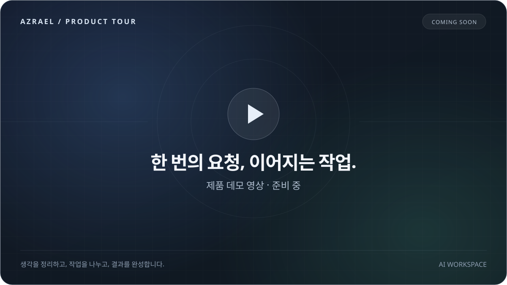

제품 데모 영상은 준비 중입니다.

## ✨ 작업에 집중할 수 있도록

Azrael은 Codex를 바탕으로 확장한 독립 AI 작업 환경입니다. 여러 모델과 에이전트를 오가며 일할 때 필요한 설정, 협업, 작업의 연속성을 한곳에 모았습니다.

<table>
<tr>
<td width="50%" valign="top">
<h3>원하는 모델로, 같은 흐름에서</h3>

여러 제공자의 계정과 사용량을 한눈에 확인합니다. 대화 중에도 작업에 맞는 모델을 고르고, 긴 대화는 컨텍스트 압축으로 이어갑니다.

<a href="#5-stay-in-flow">계정과 대화 기능 →</a>
</td>
<td width="50%" valign="top">
<h3>나에게 맞는 작업 방식</h3>

자주 쓰는 지침과 스킬을 Profile로 구성합니다. 반복되는 설정을 저장해 프로젝트에 맞게 선택하고, 재사용할 구성을 패키지로 공유합니다.

<a href="#2-compose-your-workflow">Profile과 구성 →</a>
</td>
</tr>
<tr>
<td width="50%" valign="top">
<h3>나누어 실행하고, 이어서 완성</h3>

root가 작업을 조율하고 subagent가 맡은 범위에 집중합니다. 작업 기록을 공유하고, 필요한 결과를 기다린 뒤 통합과 검증으로 이어갑니다.

<a href="#3-work-in-parallel">에이전트 협업 →</a>
</td>
<td width="50%" valign="top">
<h3>코드 밖의 화면까지</h3>

Window Use로 선택한 앱을 관찰하고 지원되는 동작을 수행합니다. 작업 대상과 중지 방법을 화면에 표시합니다. Windows에서 개발 중인 실험 기능입니다.

<a href="#4-window-use--같은-화면-다른-커서">Window Use →</a>
</td>
</tr>
</table>

중요한 대화에는 **플래그**를, 작업 중 떠오른 질문에는 `/btw`를, 이미지 설명에는 **스케치**를 사용합니다. 작은 조작도 작업의 흐름을 이어주도록 다듬고 있습니다.

> **현재는 Direct로 시작하세요.** Team과 가상 입력은 개발·실험 단계입니다. 아래 기능 소개는 현재 소스를 기준으로 하며, 설치한 릴리스에 따라 제공 범위가 다릅니다.

## 빠르게 시작하기

1. **설치하기** — [Releases](https://github.com/felrer/Azrael/releases)에서 운영체제에 맞는 패키지를 받고, 동봉된 `INSTALL.md`를 따릅니다.
2. **계정 연결하기** — Azrael의 **계정 및 사용량**에서 계정을 연결하고 모델을 선택합니다.
3. **첫 작업 맡기기** — Direct에서 원하는 결과와 제약을 설명합니다. 프로젝트의 설계부터 코드 수정까지 필요한 범위로 시작합니다.

**Windows x64 · Linux x64(glibc) · macOS(Apple Silicon)** 패키지를 대상으로 합니다. 플랫폼별 검증 범위와 Windows 전용 기능은 [설치·지원 안내](#플랫폼과-설치)에서 확인하세요.

[설치 안내](docs/ops/app-release.md) · [계정 연결](docs/ops/provider-accounts.md) · [개발에 참여하기](#개발과-문서)

## 함께 다듬어가는 Azrael

실제 작업에서 막혔던 순간이나 필요한 기능을 [Issues](https://github.com/felrer/Azrael/issues)에 남겨주세요. 재현 방법과 사용 환경이 있으면 개선에 도움이 됩니다. 구현이나 문서에 기여하려면 [프로젝트 가이드](AGENTS.md)부터 읽어주세요.

---

## 설계와 구현

**모델을 호출하는 도구에서, 작업을 이어가는 하네스로.**

Azrael은 **Codex 기반의 독립 AI 작업 환경**입니다. 엔진과 UI를 출발점으로 삼았지만, 지침 조합·다중 제공자·에이전트 협업·작업 기억·산출물 관리·창 제어를 지속적으로 확장하고 있습니다. 기본 실행 흐름을 공유하면서도, 작업을 구성하고 이어가는 방식에는 많은 차이가 생겼습니다. 이 구조는 앞으로도 개선합니다.

현재 VS Code의 통합 확장으로 실행합니다. 계정·대화·설정은 일반 Codex와 분리된 `~/.azrael-ex`에 보관합니다.

> **개발 상태** — 이 README는 현재 소스의 기능과 설계를 함께 설명합니다. 설치한 릴리스의 제공 범위는 다를 수 있습니다. **일상 작업은 Direct를 권장**하며, Team과 가상 입력은 개발·실험 단계입니다. 기능별 경계는 해당 절과 [아키텍처 문서](docs/architecture/README.md)에 표시합니다.

## 목차

- [1. Harness Architecutre](#1-harness-architecutre)
  - [요청이 실행이 되기까지](#요청이-실행이-되기까지)
  - [지침을 조합하는 방식](#지침을-조합하는-방식)
  - [문서가 이어주는 맥락](#문서가-이어주는-맥락)
  - [필요한 순간에 꺼내는 스킬](#필요한-순간에-꺼내는-스킬)
  - [계획에서 작업 메모리까지](#계획에서-작업-메모리까지)
- [2. Compose Your Workflow](#2-compose-your-workflow)
  - [Profile — 작업 방식의 기본 단위](#profile--작업-방식의-기본-단위)
  - [Direct와 Team — 하나의 루트에서 여러 작업으로](#direct와-team--하나의-루트에서-여러-작업으로)
  - [변경을 공유하고 검증하는 방식](#변경을-공유하고-검증하는-방식)
  - [설정을 넘어 패키지로](#설정을-넘어-패키지로)
- [3. Work in Parallel](#3-work-in-parallel)
  - [root는 시간을, subagent는 토큰을](#root는-시간을-subagent는-토큰을)
  - [기다리는 동안에는 추론도 멈춥니다](#기다리는-동안에는-추론도-멈춥니다)
  - [작업의 끝에는 정리까지](#작업의-끝에는-정리까지)
- [4. Window Use — 같은 화면, 다른 커서](#4-window-use--같은-화면-다른-커서)
- [5. Stay in Flow](#5-stay-in-flow)
- [시작하기](#시작하기)
- [개발과 문서](#개발과-문서)
- [라이선스와 출처](#라이선스와-출처)

## 1. Harness Architecutre

### 요청이 실행이 되기까지

큰 흐름은 일반적인 에이전트 하네스와 같습니다. **설정에 맞춰 컨텍스트를 구성하고, 모델의 응답이나 도구 호출을 처리한 뒤, 결과를 다음 추론으로 연결합니다.** Azrael은 이 흐름에 역할·작업 기록·실행 수명 관리를 더합니다.

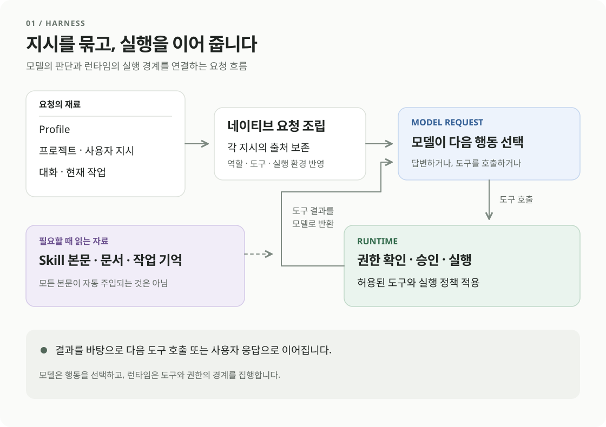

1. **구성을 정합니다.** Profile, 역할, 프로젝트 지침과 현재 실행 환경을 확인합니다.
2. **요청을 조합합니다.** 지침·대화·도구 정의와 필요한 작업 맥락을 모델에 전달합니다.
3. **모델이 다음 행동을 선택합니다.** 답변하거나, 허용된 도구에 작업을 요청합니다.
4. **런타임이 실행합니다.** 권한·승인·입출력 경계를 확인하고 결과를 돌려줍니다. 모델은 그 결과로 작업을 이어갑니다.

Profile은 뒤에서 설명할 **재사용 가능한 에이전트 구성**입니다. 프롬프트를 바꿔도 파일 권한이나 실행 가능한 도구가 저절로 늘어나지는 않습니다.

### 지침을 조합하는 방식

하나의 거대한 고정 프롬프트 대신, 출처와 책임이 다른 지침을 조합합니다.

| 구성 | 담는 내용 |
| --- | --- |
| **하네스 공통 지침** | 기본 행동, 도구 사용, 권한과 실행 환경의 경계 |
| **사용자·프로젝트 지침** | 사용자의 작업 원칙, `AGENTS.md`, 프로젝트별 규칙 |
| **Profile·역할 지침** | 선택한 추가 지침과 root·subagent·Lead의 책임 |
| **현재 작업의 맥락** | 요청, 대화, 읽어 온 계획·문서·메모리, 도구 결과 |

이 표는 구성 요소를 나타냅니다. 모든 내용이 같은 권한의 시스템 메시지로 합쳐지는 것은 아닙니다. 제공자에 맞춰 요청 형식을 변환해도 **사용자·프로젝트·도구 결과의 출처와 권한은 유지**합니다.

스킬은 목록으로 발견하고, 필요한 본문과 참조 자료를 읽습니다. 모델 전환이나 기능 상태 변경 때는 교체 가능한 지침을 갱신하며, 저장된 대화 자체를 지우지 않습니다. 프로필의 요청 스냅샷은 접수 당시 구성을 보존해 진행 중인 요청에 새 설정이 섞이지 않도록 설계되어 있습니다.

[프롬프트와 도구 프로필](docs/architecture/model-harness-profiles.md) · [지침 조합과 상태 갱신](docs/architecture/instructions.md#native-instruction-state-and-prompt-projection)

### 문서가 이어주는 맥락

`project-bootstrap`은 프로젝트의 문서 진입점과 작업 지침을 정리합니다. 코드를 생성하기보다 **다음 세션이 어디서 무엇을 읽을지** 정하는 스킬입니다.

| 위치 | 맡는 역할 |
| --- | --- |
| `docs/architecture/` | 시스템의 구조·동작·설계 의도. 코드 위치와 수정 이력은 별도 소유자에 둡니다. |
| `docs/maps/` | 필요한 문서와 구현으로 빠르게 연결하는 지도 |
| `docs/ops/` | 실행·배포·복구를 위한 재현 가능한 절차 |
| `docs/playbooks/` | 사용자가 관리하는 작업 원칙과 적용 조건 |
| `work/` | 개별 작업의 계획·결정·검증과 공유 메모리 |

기본 playbook인 `work.md`, `app-logging.md`, `artifact-lifecycle.md`는 범위 유지, 오류 추적, 산출물 정리에서 반복되는 누락을 보완합니다. 해당 문서가 필요한 작업으로 안내하며, 모든 문서를 매번 읽게 하지는 않습니다.

스킬·Playbook·참조 문서는 Profile의 구성요소로 선택할 수 있습니다. 프로젝트 파일을 만든 것과 Profile에 등록해 적용하는 것은 별도 단계입니다.

### 필요한 순간에 꺼내는 스킬

| 스킬 | 사용하는 때 |
| --- | --- |
| [`project-bootstrap`](instructions/skills/project-bootstrap/SKILL.md) | 새 프로젝트의 문서 체계를 만들거나 기존 진입점을 정렬할 때 |
| [`design-collaboration`](instructions/skills/design-collaboration/SKILL.md) | 사용자의 선택에 따라 다음 설계가 달라져 여러 차례 논의가 필요할 때 |
| [`design-documentation`](instructions/skills/design-documentation/SKILL.md) | 합의한 요구사항과 동작을 담당 설계 문서에 반영할 때 |
| [`development-workflow`](instructions/skills/development-workflow/SKILL.md) | 목표가 정해져 조사·계획·질문·검증 기준을 구성할 때 |
| [`implementation`](instructions/skills/implementation/SKILL.md) | 승인된 범위의 구현·수정·검증·정리를 수행할 때 |
| [`testing`](instructions/skills/testing/SKILL.md) | 변경에 필요한 검증과 유지할 테스트를 판단할 때 |

스킬은 고정된 여섯 단계가 아닙니다. 작업에 맞는 경로를 선택하고, 단계가 바뀌어도 **같은 작업 기록과 합의된 범위**를 이어갑니다.

### 계획에서 작업 메모리까지

작업 계획은 `work/<작업>/nn-plan.md`에 둡니다. 요구사항·승인·공통 결정·완료 기준을 유지하고, 현재 단계와 검증 결과를 갱신합니다.

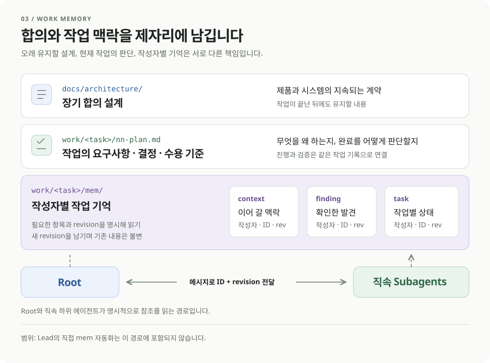

선택형 `task_memory`는 같은 작업 폴더의 `mem/`에 조사 결론·차단·결과를 저장합니다. root는 공통 `context`를, 각 세션은 자신의 `finding`·`task`를 작성합니다. 수정은 새 불변 버전으로 남고, 작성자는 다른 세션의 기록을 덮어쓰지 않습니다.

root는 작업을 배정할 때 **항목 ID와 버전**을 지정합니다. subagent는 필요한 기록만 읽고, 결과는 한 번 저장한 뒤 메시지에 참조를 보냅니다. 전체 대화를 반복해서 인계하는 부담을 줄이기 위한 구조입니다.

현재 공유 계약은 **root와 직접 생성한 subagent**를 중심으로 합니다. Lead까지의 자동 주입이나 자동 알림을 뜻하지 않으며, 메모리 저장은 메시지·판단 요청·완료 신호를 대신하지 않습니다. 역할별 메모리 지침은 Profile에서 선택하며 기본 비선택입니다.

[작업 메모리 설계](docs/architecture/task-memory.md) · [작업 문서 규칙](work/README.md)

## 2. Compose Your Workflow

### Profile — 작업 방식의 기본 단위

**Profile은 모델의 작업 방식을 저장한 구성 단위**입니다. 지침과 리소스를 묶고, 허용 역할과 필요에 따른 제공자·모델·reasoning 설정을 지정합니다. 같은 모델도 서로 다른 Profile로 조사·구현 등 다른 역할을 맡길 수 있습니다.

- **조합** — 기본 지침, 스킬, MCP 연결, Playbook, 참조 문서와 역할을 선택합니다. 추가 기본 지침은 순서를 정하고, 스킬·MCP는 활성화할 목록을 고릅니다.
- **복제** — 읽기 전용 기본 Profile이나 패키지 템플릿에서 개인 구성을 만듭니다. Azrael 핵심 지침은 고정됩니다.
- **저장과 적용** — 저장한 구성과 현재 프로젝트에 활성화한 구성을 구분합니다. 일반 대화에는 Root 호환 Profile 하나를 적용합니다.
- **검증** — 잘못된 구성도 편집용으로 저장할 수 있지만 활성화는 막습니다. 기존 활성 구성은 마지막 유효 버전을 유지합니다.

추가 지침을 선택하지 않을 수도 있습니다. 리소스 선택은 MCP 설치·인증·권한 승인을 대신하지 않습니다. **지침이 있는 것과 실행 권한이 있는 것은 별개**입니다.

*통합 편집·저장·생성 경로는 소스에 구현되어 있습니다. 선택한 리소스만의 native 적용과 설치본 수용은 별도 검증 범위입니다.*

[Profile 구성](docs/architecture/instructions.md#profile-composer) · [역할 프로필](docs/architecture/instructions.md#role-profiles-for-team-and-direct)

### Direct와 Team — 하나의 루트에서 여러 작업으로

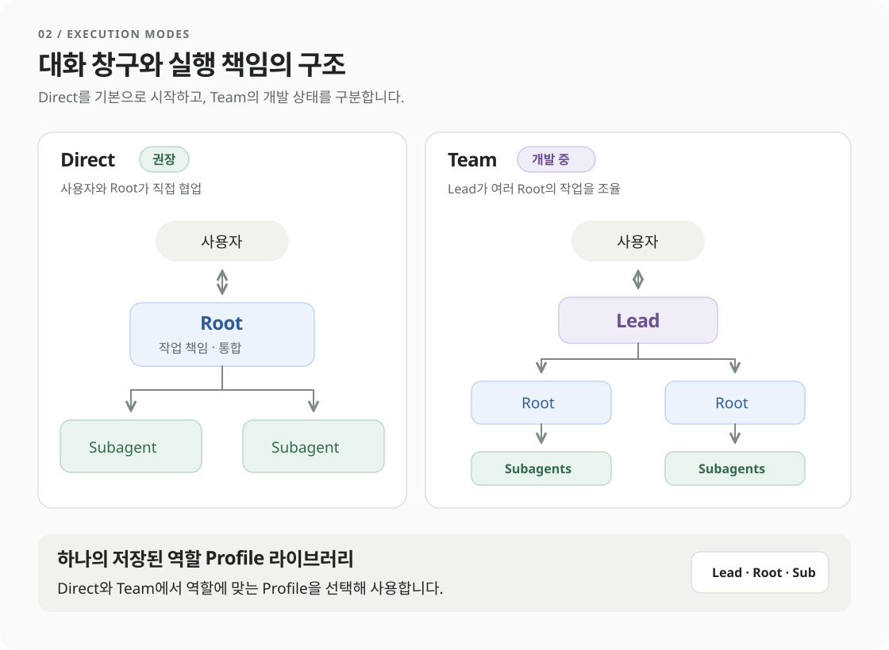

| | Direct | Team |
| --- | --- | --- |
| **대화 상대** | root | Lead |
| **작업 구조** | root와 그 subagent | Lead 아래 여러 root와 각 subagent |
| **저장하는 구성** | Root Profile과 Subagent 목록을 담은 전역 설정 한 개 | Lead Profile 하나와 사용할 Root·Subagent 목록을 담은 여러 프리셋 |
| **용도** | 하나의 작업을 직접 맡기고 필요한 부분을 위임 | 여러 작업의 요청·상태·결과를 중앙에서 조율 |
| **권장 상태** | 일상 작업에 권장 | 개발 중, 현재 사용 비권장 |

Direct는 기존 Codex의 root–subagent 구조에 해당합니다. 단일 에이전트만 실행한다는 뜻은 아닙니다. Team은 이 작업 단위를 Lead 아래 묶는 구조입니다.

**새 채팅 버튼을 우클릭**하거나 길게 누르면 Direct와 저장된 Team 프리셋의 시작 메뉴를 엽니다. 프리셋을 선택하고 첫 메시지를 보내면 해당 구성으로 세션을 만듭니다.

생성된 Team은 Profile과 필요한 고정 리소스의 복사본을 보존합니다. 원본 Profile을 수정·삭제해도 기존 Team의 구성이 따라 바뀌지 않습니다. Team 안의 Profile 수정은 이후 생성하는 자식에게 적용하고, 이미 생성한 세션은 자신의 구성을 유지합니다.

역할별 부가 지침은 각 Profile에 둡니다. Team 생성 요청의 `developerInstructions`를 공통 기반 지침으로 저장하는 경로도 있지만, **저장된 Team 프리셋에 독립적인 추가 지침 편집란이 있는 것은 아닙니다.**

Team의 승인 요청은 Lead 화면으로, Direct의 요청은 root 화면으로 모으는 구조입니다. 승인자는 사용자이며, 한 세션의 승인이 Team 전체 권한으로 확대되지 않습니다.

[Team과 Direct](docs/architecture/work-orchestration.md#team과-direct)

### 변경을 공유하고 검증하는 방식

Team은 **Git의 코드 이력 위에 작업 상태를 연결**합니다. Git을 대체하는 자체 파일 저장소가 아닙니다.

| 저장하는 것 | 담당 |
| --- | --- |
| 코드 내용과 이력 | Git 객체·커밋 |
| 요구사항 버전, 변경 단위와 revision, 의존성 | Team 변경 관리 원장 |
| 검증된 기준점과 반영 상태 | 전용 Git ref와 검증 기록 |

목표 흐름은 **기준점 선택 → 변경 제출 → 의존성 확인 → 통합 검증 → 반영**입니다. 작업자는 격리된 변경을 넘기고, 통합 담당은 검증된 기준점을 관리합니다.

현재 서비스는 기존 커밋을 고정하고 상태를 추적합니다. 후보 생성·테스트 실행·활성 worktree 통합 전체를 자동으로 수행하지는 않습니다. 내부 checkpoint를 외부 커밋으로 변환하는 흐름도 아직 완성되지 않았습니다. 외부 저장소로 push하거나 게시하는 권한은 별도로 유지합니다.

[Team 변경 관리](docs/architecture/work-orchestration.md#team-변경-관리)

### 설정을 넘어 패키지로

지침·스킬·Playbook·참조 문서·역할과 **Profile 템플릿**은 패키지로 묶어 저장하고 공유합니다. 이름·설명·이미지와 구성 파일을 함께 보존하고, 버전과 내용 해시로 가져올 대상을 고정합니다. 역할 Profile의 모델 설정은 생략할 수 있지만, 공유용 `task-profile` 형식은 모델과 고정 의존성을 지정합니다.

패키지를 가져오는 것, 개인 Profile을 만드는 것, 프로젝트에 활성화하는 것, 원격에 게시하는 것은 각각 별도 동작입니다. 로컬 구성은 로컬에 남길 수 있고, 공개·협업자용 배포는 연결된 GitHub 저장소의 권한과 게시 검사를 따릅니다. 계정 인증과 지침 공유는 분리하며, 게시 시 알려진 비밀정보 경로와 패턴을 검사합니다.

현재 패키지의 지원 범위는 리소스와 Profile 템플릿입니다. **Team 프리셋과 Direct 전역 설정을 통째로 내보내고 복원하는 기능은 포함하지 않습니다.**

[패키지와 배포](docs/architecture/instructions.md#package-development-workbench)

## 3. Work in Parallel

### root는 시간을, subagent는 토큰을

root는 요구사항·의존관계·공유 계약을 정리하고, 작업을 배정하며 결과를 통합합니다. subagent는 지정된 범위와 결과 하나에 집중합니다. **전체 완료 시간과 반복 인계 비용을 함께 줄이는 방향**입니다.

| 역할 | 받는 지침과 책임 |
| --- | --- |
| **root** | 공통·프로젝트 지침과 root 조정 지침. 실행 순서·공유 자원·통합·최종 검증을 담당합니다. |
| **subagent** | 자신의 역할·Profile 지침과 목표·소유 파일·제약·참조·완료 기준. 실제 결과와 미검증 범위를 보고합니다. |

부모 대화를 공유하더라도 부모 전용 역할과 권한까지 물려받지는 않습니다. 조사용 `luna_explorer`, 구현·검증용 `sol_executor`처럼 목적이 분명한 기본 프로필을 제공합니다.

**소통은 목적에 따라 세 경로로 나눕니다.**

| 경로 | 서브에이전트가 사용하는 때 | 루트에 미치는 영향 | 효율적인 이유 |
| --- | --- | --- | --- |
| **메시지** (`send_message`) | 진행 상황, 검증 결과, 다음 작업에 넘길 수 있게 준비된 결과물 | 메일로 저장됩니다. 실행 중인 루트는 다음 단계에서 읽고, 대기 중인 루트는 **깨우지 않습니다**. | 관련 내용이 누적되어 한꺼번에 전달되므로 일상적인 보고 때문에 루트가 턴을 더 쓰지 않습니다. |
| **결정 요청** (`request_parent`) | 직속 부모의 결정이나 조율이 지금 필요할 때 | 대기 중인 루트를 깨우거나, 실행 중인 루트의 다음 안전한 처리 시점에 합류합니다. 루트는 `resolved`, `cancelled`, `deferred` 중 하나로 답합니다. | 자식은 독립 작업을 계속하고, 막힌 동작만 멈춘 채 `await_parent_response`로 답을 기다립니다. |
| **최종 보고** | 배정이 성공, 실패, 부분 결과로 끝났을 때 | 종료 상태가 됩니다. 이 자식을 `all_terminal`로 기다리던 루트가 재개됩니다. | 범위, 종료 코드, 로그, 미검증 항목을 담은 보고 한 번이 반복적인 상태 확인을 대신합니다. |

### 비용과 시간: 같은 조사 과제를 1회씩 비교

읽기 전용 소스 조사 과제를 다섯 조건에서 한 번씩 실행했습니다. Azrael 세 조건은 모두 **확장 2026.0.19 / 엔진 0.162.0**, Codex 두 조건은 모두 **확장 26.1021.22027 / 엔진 0.164.0-alpha.11.1**입니다. 부모 모델은 모두 GPT-6.1 Sol/medium으로 유지했습니다. 두 제품의 부모 단독 조건은 같은 영어 과제와 동일한 위임 금지 지시를 사용하고 실제 자식 생성 0건을 확인했습니다.

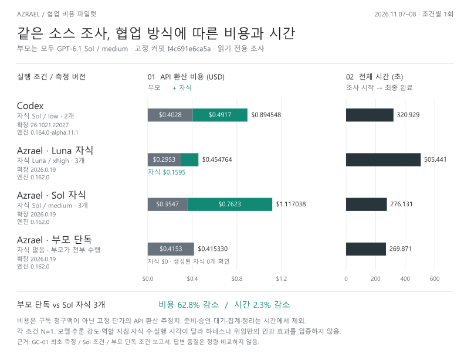

이번 측정에서 Azrael의 Luna/xhigh 조건은 Codex 협업 조건보다 **비용이 49.2% 낮고 시간은 57.5% 길었습니다.** Azrael의 Sol/medium 자식 조건은 Codex 협업 조건보다 **시간이 14.0% 짧고 비용은 24.9% 높았습니다.** Azrael 부모 단독은 **269.871초, 부모 $0.4153304 / 자식 $0**로, Azrael Sol 자식 조건보다 **비용이 62.8% 낮고 시간은 2.3%(6.260초) 짧았습니다.**

Codex 부모 단독은 **236.200초, 부모 $0.3618328 / 자식 $0**로, Codex 협업 조건보다 **비용이 59.6% 낮고 시간은 26.4% 짧았습니다.** 부모 단독끼리 비교하면 이번 1회에서 Codex는 Azrael보다 **비용이 12.9% 낮고 시간은 12.5%(33.671초) 짧았습니다.**

각 조건 1회이며 자식 모델·추론 강도·제품/역할 지침·자식 수·실행 시각·캐시 상태가 다릅니다. 답변 품질도 정량 비교하지 않았으므로, 하네스나 협력 지침만의 효과 또는 서브에이전트 사용의 일반적 우열을 입증하지는 않습니다.

비용은 실제 ChatGPT 구독 청구액이 아닌 API 환산 추정치입니다. 시간은 조사 시작부터 최종 완료까지이며 준비·승인 대기·정리는 제외했습니다. [최초 측정](work/GC-01-collaboration-cost-pilot/report.md), [Sol 자식 조건](work/GC-01-collaboration-cost-pilot/sol-result-report.md), [Azrael 부모 단독](work/GC-01-collaboration-cost-pilot/solo-result-report.md), [Codex 부모 단독 보고서·검증](work/GC-01-collaboration-cost-pilot/codex-solo-report.md), [공유용 PNG](docs/images/collaboration-cost-ko.png)에서 상세 수치와 근거를 볼 수 있습니다.

### 기다리는 동안에는 추론도 멈춥니다

root가 다음 단계로 넘어가려면 빌드나 subagent의 결과가 필요한 순간이 있습니다. `defer_root`는 이 의존 지점에서 **재개 조건을 저장하고 모델 호출을 멈춥니다.**

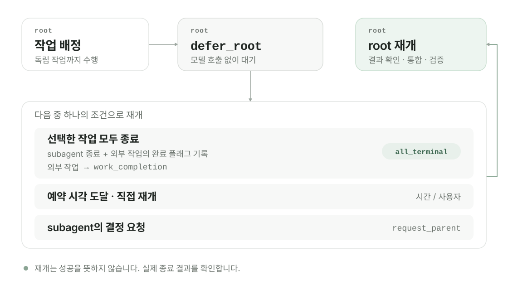

- **자식 작업** — 선택한 subagent들이 모두 종료되면 재개합니다.
- **외부 작업** — `work_completion`으로 실행을 등록하고, 실제 종료 플래그를 재개 조건에 연결합니다. 관리 명령은 실행기가 종료 결과를 기록합니다.
- **예약과 개입** — 지정 시각은 최종 대기 한도이며, 부모 판단 요청이나 사용자의 수동 재개도 별도 경로로 처리합니다.

일반 진행 메시지는 대기 중인 root를 깨우지 않습니다. 성공·실패·취소는 모두 종료일 수 있으므로, 재개한 root가 결과를 확인하고 통합·검증합니다. 종료가 불명확한 상태를 성공으로 바꾸지 않습니다.

*현재 `defer_root` 제공 범위는 검증된 native OpenAI root 경로입니다. 다른 제공자의 동등한 재개 지원을 뜻하지 않습니다.*

[대기와 재개](docs/architecture/root-resume.md)

### 작업의 끝에는 정리까지

출력·로그·임시 복사본 중 **등록된 산출물은 작업·실행·버전 단위로 묶어 정리와 보존을 확인**합니다. 공유 캐시는 소유자 하나와 여러 소비 참조를 가집니다.

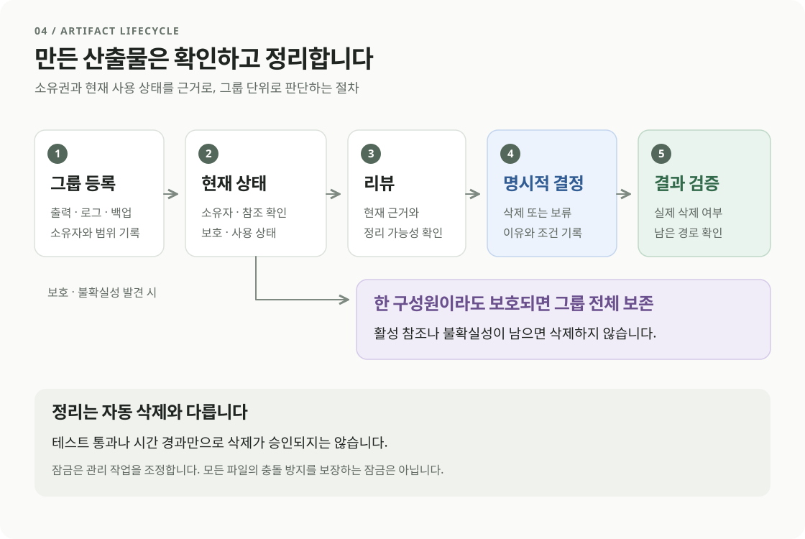

| 도구 | 책임 |
| --- | --- |
| `project_inventory` | 소유자·구성원·참조·보호 상태와 묶음 등록 |
| `project_tests` / `project_build` | 선택한 검증·빌드의 계획, 실행, 실제 종료 결과 기록 |
| `project_cleanup_review` | 현재 상태를 검토하고 검토 대상에 묶인 토큰 발급 |
| `project_cleanup_apply` | 명시한 삭제·보류 결정을 적용하고 실제 결과 확인 |

**기본 정리 원칙은 사용이 끝난 작업 소유의 일회성 자료를 지우는 것**입니다. 소스·사용자 문서·합의된 결과물까지 삭제하는 것은 아닙니다. 정리 대상 중 계속 남길 자료는 명시적인 사용자 보존 승인을 받습니다. 정상 동작 확인에 필요한 최소 복구 자료는 안내한 범위로 보존하고 확인 뒤 정리합니다.

관리 프로토콜을 따르는 실행기는 로컬 OS 잠금과 묶음별 예약으로 같은 산출물의 생성·등록·정리를 조정합니다. 관계없는 묶음은 병행할 수 있습니다. 프로젝트의 모든 파일을 자동 잠그거나, 관리 경로 밖의 편집 충돌까지 없애지는 않습니다.

구성원 하나라도 사용 중이거나 보호·소유권·종료 상태가 불명확하면 묶음 삭제를 막습니다. 검증 통과만으로 삭제하지 않으며, 일부 삭제가 실패하면 실제 남은 파일과 진단 근거를 보존합니다.

내장 관리 도구와 독립 실행기 `maintenance_owner`는 같은 Rust 관리 코드를 사용합니다. 이 체크아웃의 정리는 검증된 독립 실행기를 사용하는 운영 경로도 유지합니다. 설치 앱에 모든 최적화가 통합되었다고 가정하지 않습니다.

[산출물 설계](docs/architecture/project-maintenance.md) · [관리 운영](docs/ops/project-maintenance.md) · [보존과 정리 원칙](docs/playbooks/artifact-lifecycle.md)

## 4. Window Use — 같은 화면, 다른 커서

Window Use는 앱을 관찰하고 조작하는 권한을 단계별로 나눕니다. 기능을 켠 뒤 1단계 관찰에는 앱별 승인을 요구하지 않으며, 제어에는 단계와 앱에 맞는 승인을 적용합니다. 실패했다고 더 넓은 제어 권한으로 넘어가지 않습니다.

| 단계 | 범위 |
| --- | --- |
| **1 · 관찰** | 창 캡처, UI 구조·상태 확인 |
| **2 · 선택 창 제어** | 지원되는 UI Automation 동작과 작업 매크로 |
| **3 · 별도 실행 세션** | 사용자 작업 공간과 분리한 Windows 자식 세션 — 수용 범위 제한 |
| **4 · 데스크톱 제어** | 화면 전반의 입력 — 별도의 승인과 경계 |

### 어디서 작업하는지 보이도록

선택한 창에는 **모서리의 은은한 빛과 중지 안내 오버레이**를 표시합니다. 표시용 창은 클릭을 통과시키고, 대상의 이동·크기 변경과 실행 수명에 맞춰 갱신합니다. **Ctrl+Alt+Shift+F12**로 제어와 대기를 멈춥니다. 일반 Esc는 앱에 전달합니다.

### 커서는 둘, 입력 경로는 구분해서

[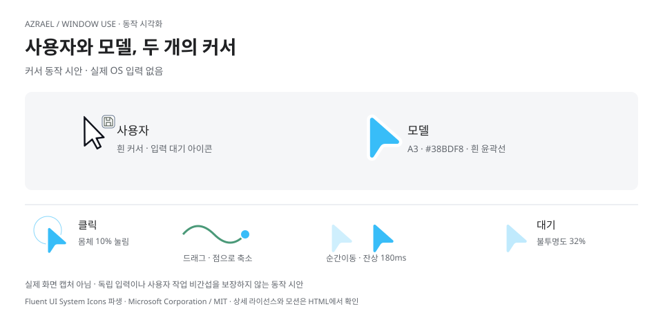](docs/images/window-use-cursor-ko.html)

[커서 애니메이션 열기](docs/images/window-use-cursor-ko.html) · 로컬 HTML에서 재생·일시정지·구간 이동·밝은/어두운 배경을 확인할 수 있습니다.

흰 화살표는 사용자, 파란 화살표는 모델을 나타냅니다. 클릭은 짧은 눌림으로, 드래그는 입력 위치의 점으로 표현합니다. 전환은 교차 페이드로, 순간이동은 짧은 잔상으로 연결합니다. **이 자료는 실제 OS 입력을 보내지 않는 동작 시안**입니다. A3 모양과 애니메이션은 네이티브 오버레이에 아직 적용하지 않았으며, 현재 구현은 정적인 삼각형과 이름표를 사용합니다.

새 커서 표시와 가상 입력은 서로 다른 구현입니다.

| 경로 | 현재 동작과 한계 |
| --- | --- |
| **Window Use 선택 창 제어** | UI Automation을 이용합니다. 지원 동작은 앱마다 다르고, 대상 창이 활성화될 수 있습니다. |
| **Switched 다중 커서 실험** | 준비된 협업 상태에서는 시스템 커서를 숨기고 사용자·모델 오버레이를 표시하며, 해제하면 복원합니다. 커서 이동 표시는 논리적으로 분리하지만 클릭·드래그는 공유 OS 입력을 사용합니다. |
| **`virtual_input` 실험** | 선택한 프로세스·스레드 안에서 입력을 전달해 전역 커서·실제 포커스·클립보드 변경을 피하는 경로입니다. Windows x64의 소유 테스트 창 범위이며 일반 앱·설치 수용은 미완료입니다. |

따라서 **모든 앱에서 사용자 작업을 방해하지 않는 제어는 아직 보장하지 않습니다.** 다중 커서의 Paint 시험과 별개로, 독립적인 키보드·IME 사용 및 드래그 종료 시 커서 복구 문제는 남아 있습니다. 오버레이 표시 검증도 일반 앱의 입력 격리를 의미하지 않습니다.

Window Use는 현재 **Windows 전용**입니다. Linux 구현과 일부 과거 시험 기록은 남아 있지만 제품에서는 비활성화되어 있으며, macOS 지원도 제공하지 않습니다.

[Window Use](docs/architecture/window-use.md) · [표시와 중지](docs/architecture/window-use-visualization.md) · [다중 커서](docs/architecture/multi-pointer.md) · [가상 입력](native/virtual-input/README.md)

## 5. Stay in Flow

### 여러 계정과 모델, 하나의 작업 흐름

**계정 및 사용량**에서 제공자별 계정과 남은 사용량을 확인합니다. 현재 계정, 재인증, 전환과 자동 전환 허용을 한곳에서 관리하며, 조회 실패를 사용량 0으로 표시하지 않습니다.

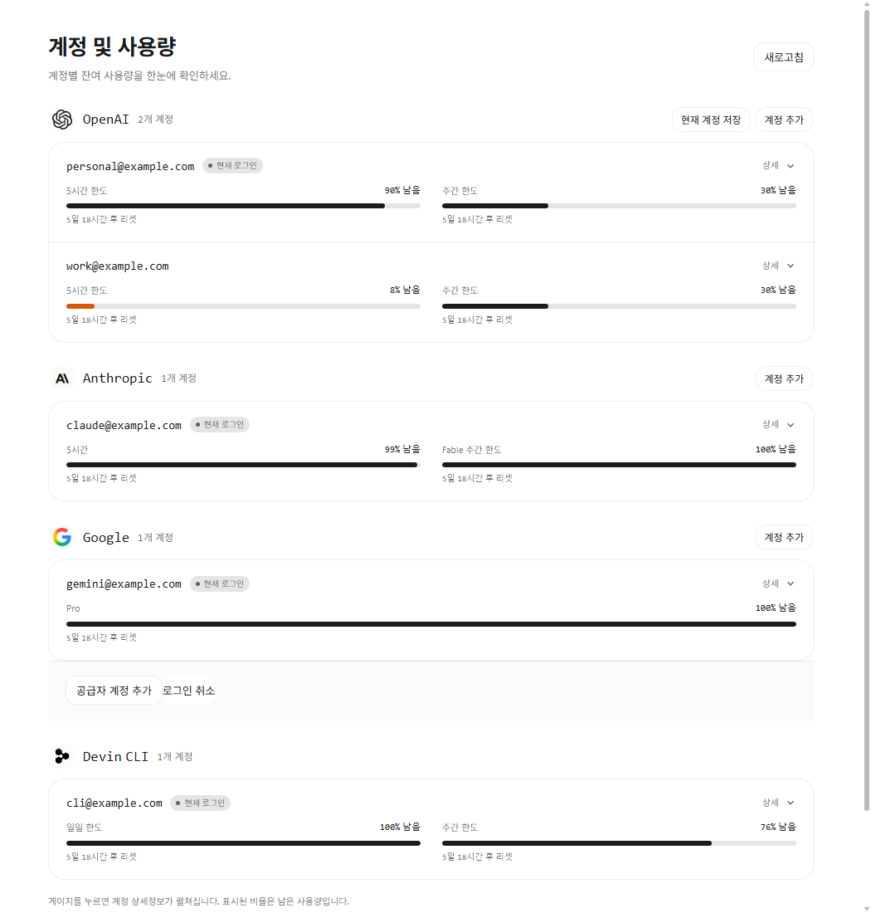

모델 선택기는 여러 제공자와 사용자 등록 API를 연결합니다. 모델·reasoning을 작업에 맞게 바꾸고, subagent에도 다른 제공자의 모델을 배정할 수 있습니다. 실행 중인 요청은 기존 구성을 유지하며, 모델 변경은 다음 요청 경계에 적용합니다. 제공자·모델마다 도구와 인증 지원 범위는 다릅니다.

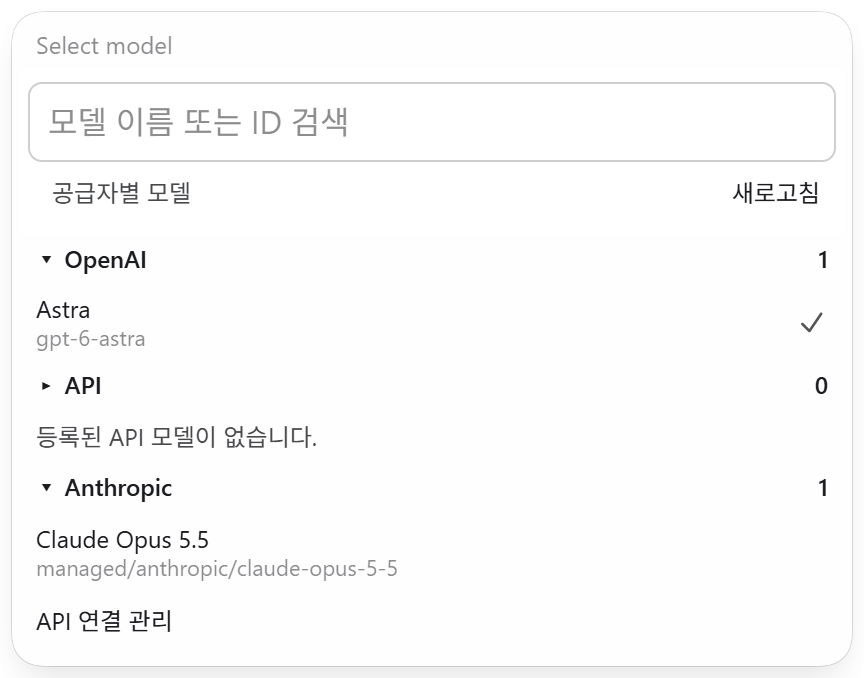

[계정](docs/architecture/accounts.md) · [제공자 전환](docs/architecture/managed-providers.md) · [사용자 API](docs/architecture/custom-api-models.md)

### 길어져도 이어지는 대화

컨텍스트 게이지에서 사용량을 보고 자동 압축 기준을 조정합니다. 수동 압축은 실행 중인 턴을 끊지 않고 대기열에 넣습니다. 압축은 앞선 기록을 정리해 이어가는 동작이며, 저장된 원본 대화를 삭제하는 기능이 아닙니다.

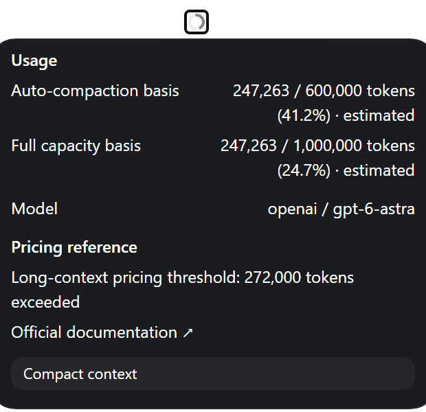

다시 로드한 뒤에는 대기 입력과 접수 상태를 대조해 복구합니다. 이미 접수된 요청을 무조건 다시 보내지 않습니다. 작업 시간 표시도 병렬 실행 시간을 단순 합산하지 않고 기록된 실행·대기 구간을 사용합니다.

[컨텍스트 정책](docs/architecture/context-policy.md) · [압축 대기열](docs/architecture/queued-compaction.md) · [재개 복구](docs/architecture/reload-recovery.md) · [작업 시간](docs/architecture/task-work-time.md)

### 작은 조작이 줄이는 인지 부하

| 기능 | 줄여주는 수고 |
| --- | --- |
| **세션 플래그** | 중요한 대화를 빨간 깃발로 표시하고 플래그 필터로 다시 찾습니다. |
| **`/btw` 곁가지 질문** | 본 작업을 유지한 채 별도 패널에서 질문합니다. 도구 실행 없이 참고 맥락으로 답하고, 명시적으로 전달한 내용만 본 작업에 보냅니다. |
| **이미지 위 스케치** | 첨부 이미지 위에 위치와 의도를 표시해 전달합니다. 원본 대화의 이미지를 수정하지 않고 새 첨부나 편집 중인 초안에 반영합니다. |
| **프로젝트 사용량** | 일별 달력과 프로젝트별 비교로 API 환산 사용 가치를 봅니다. 구독 결제액이나 실제 청구서와는 구분합니다. |
| **Auto-Review** | 지원되는 native OpenAI 경로에서 기존 Guardian 리뷰어로 검토 대상 작업을 심사합니다. 샌드박스와 별도 사용자 승인은 유지합니다. |

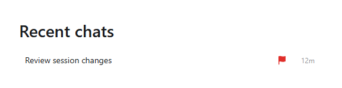

*곁가지 질문·스케치·사용량 등은 기능별 소스·렌더 검증과 설치 수용 범위가 다릅니다.* [곁가지 질문](docs/architecture/side-questions.md) · [이미지 스케치](docs/architecture/ui-presentation.md#sketch-on-an-attached-image) · [사용량 집계](docs/architecture/project-usage.md) · [Auto-Review](docs/architecture/auto-review.md)

## 시작하기

### 플랫폼과 설치

| 대상 | 핵심 앱 | Window Use |
| --- | --- | --- |
| **Windows x64** | 주요 개발·검증 환경. 릴리스별 수용 범위 확인 | 지원 경로 제공, 단계·앱별 검증 제한 |
| **Linux x64 · glibc** | 패키지·호스트 검증 기록 있음. 배포판·데스크톱별 차이 있음 | 현재 비활성 |
| **macOS · Apple Silicon** | 패키지·호스트 검증 기록 있음. 버전·제공자별 차이 있음 | 현재 미지원 |

[Releases](https://github.com/felrer/Azrael/releases)에서 운영체제에 맞는 패키지와 체크섬을 받습니다. **해당 릴리스의 `INSTALL.md`를 기준**으로 해시를 확인하고 설치합니다. 패키지는 자체 런타임을 포함하며, 원래 Codex 확장과 별도의 상태 경로를 사용합니다.

Windows는 VS Code와 PowerShell 7을 준비하고 패키지의 `install.ps1`을 실행한 뒤 창을 다시 로드합니다. Linux·macOS는 동봉된 플랫폼 설치기를 사용합니다. 실제 실행 중인 패키지 디렉터리를 임의로 지우지 않습니다.

[설치 운영](docs/ops/app-release.md) · [플랫폼 계약](docs/architecture/multi-platform.md) · [Linux 운영](docs/ops/linux.md)

### 첫 작업

1. Azrael 사이드바를 열고 **계정 및 사용량**에서 계정을 연결합니다.
2. **Direct**로 시작하고 모델을 선택합니다. Profile 편집 기능의 제공 여부는 설치한 버전을 확인합니다.
3. 원하는 결과와 제약을 설명합니다. 새 프로젝트의 문서 체계가 필요하면 `project-bootstrap`을 요청합니다.
4. 작업 계획과 필요한 질문을 확인하고, 구현·검증·정리 결과를 받습니다.

[계정 연결](docs/ops/provider-accounts.md) · [Devin 연결](docs/ops/devin-native.md)

## 개발과 문서

| 경로 | 역할 |
| --- | --- |
| [`engine/`](engine/) | Codex 기반 Azrael 엔진과 소스 출처 |
| [`extensions/azrael-ex/`](extensions/azrael-ex/) | 계정·사용량·설정과 호스트 통합 |
| [`providers/`](providers/) | 제공자 인증과 추론 연동 |
| [`native/`](native/) | Windows 창 제어와 입력 실험 |
| [`instructions/`](instructions/) | 재사용할 지침·역할·스킬 |
| [`scripts/`](scripts/) | 빌드·검증·패키징·설치 도구 |
| [`docs/`](docs/README.md) | 설계·코드 지도·운영·playbook |

기여 전 [`AGENTS.md`](AGENTS.md)와 [Work playbook](docs/playbooks/work.md)을 읽습니다. 빌드 입력과 출처를 고정하고, 소스 검증·패키징·설치 수용을 구분합니다. 전체 플랫폼이나 전체 회귀 테스트의 성공을 일부 검사로 대신하지 않습니다.

[개발과 빌드](docs/ops/development.md) · [검증·빌드 규칙](docs/playbooks/build.md) · [코드 지도](docs/maps/README.md) · [시각자료 원본과 재현](docs/images/README.md)

## 라이선스와 출처

Azrael 자체 코드와 지침에는 [MIT 라이선스](LICENSE)가 적용됩니다. Codex 기반 엔진은 [Apache-2.0 라이선스](engine/LICENSE)와 [NOTICE](engine/NOTICE)를 유지하며, 소스 정보는 [`engine/SOURCE.json`](engine/SOURCE.json)에 기록합니다. 그 밖에 가져온 구성 요소는 각자의 조건을 따르며, 제공자 연동, 런타임, 글꼴과 공식 UI 재배포 조건은 [제3자 고지](THIRD_PARTY_NOTICES.md)에 정리되어 있습니다.
