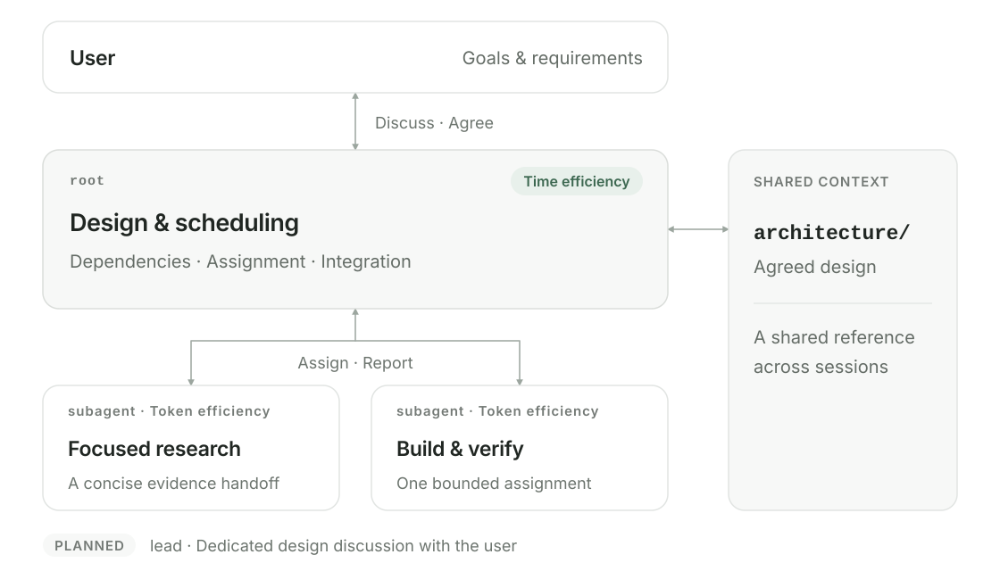
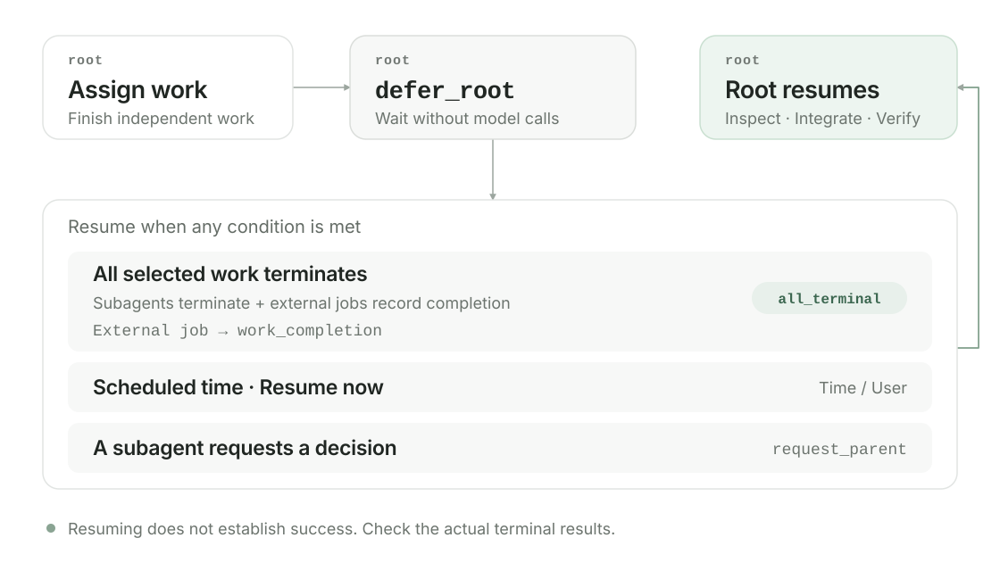

# Azrael

**English** | [한국어](README.ko.md)

Azrael is an independent VS Code host for working on code and projects with AI agents. It builds on a Codex-based engine and interface and adds what long, multi-agent work needs in practice: a root agent that coordinates bounded subagents, a scheduled resume that lets the root stop spending tokens while builds and renders run, many accounts and providers behind one picker, queued context compaction, Window Use for working alongside an agent on the same desktop, and flags for getting back to important conversations.

Azrael runs as one integrated extension. Its accounts, conversations and settings live in `~/.azrael-ex`, separate from ordinary Codex state, and installation preserves existing Codex extensions, other extensions and VS Code settings.

> [!NOTE]
> Azrael is under active development and each feature has its own verified scope. This README states those limits next to each feature; the [architecture documents](docs/architecture/README.md) are the authoritative source.

## Contents

- [Highlights](#highlights)
- [1. Agent efficiency](#1-agent-efficiency)
  - [a. Documentation](#a-documentation-that-connects-sessions)
  - [b. Custom skills](#b-custom-skills-from-discussion-to-delivery)
  - [c. Roles and communication](#c-root-for-time-subagents-for-tokens)
  - [d. Waiting and resuming](#d-waiting-without-repeated-checks-defer_root)
- [2. Reducing cognitive load](#2-reducing-cognitive-load)
  - [a. Accounts](#a-many-accounts-one-page)
  - [b. Models](#b-any-model-mid-conversation)
  - [c. Context compaction](#c-context-compaction-that-waits-its-turn)
  - [d. Window Use](#d-window-use-work-alongside-the-agent)
  - [e. Session flags](#e-session-flags)
- [Platform support](#platform-support)
- [Installation](#installation)
- [Usage](#usage)
- [Development](#development)
- [License and provenance](#license-and-provenance)

## Highlights

| Feature | What it gives you |
| --- | --- |
| **Root and subagent collaboration** guidance built in | Token-light subagents work narrow, file-owned assignments while the root schedules them in parallel and owns integration and acceptance. |
| **Scheduled root resume** | The root parks until selected subagents *and* external jobs such as builds or renders finish, instead of polling them with model requests. |
| **Accounts and usage** | Connect several accounts per provider, see remaining quota and reset times, and switch in one click. |
| **Models across providers** | OpenAI, Devin, Anthropic, Google, xAI, OpenRouter and your own API endpoints in one searchable picker; switch mid-conversation. |
| **Context compaction** | Per-model automatic thresholds plus a manual compaction you can queue without interrupting the running turn. |
| **Window Use** *(experimental)* | The agent observes and operates one selected window while your mouse, keyboard and clipboard stay with you. |
| **Session flags** | Pin a red flag on a conversation so it stands out in the Chats list. |
| **Recovery and queues** | Queued inputs survive reloads; accepted turns are reconciled instead of replayed. |

UI screenshots in this README are captured from Azrael's production components with the project's development renderers. Every account, conversation, quota and model catalog in them is **synthetic** — no personal account or session was opened. The collaboration and Window Use pictures are explanatory illustrations. See [image sources and reproduction](docs/images/README.md).

## 1. Agent efficiency

Documents carry context across sessions. Instructions shape how work gets done. The root is designed to reduce overall completion time; subagents focus on keeping each assignment's token use low.

### a. Documentation that connects sessions

`docs/` gives successive model sessions a shared design to work from. Four categories keep the next piece of context within reach.

| Category | Role |
| --- | --- |
| [`architecture/`](docs/architecture/README.md) | Maintains the system's overall structure, behavior, boundaries and design intent, separating code references and change history. |
| [`maps/`](docs/maps/README.md) | Narrows the search by connecting relevant documents and implementation entry points. |
| [`ops/`](docs/ops/README.md) | Records repeatable procedures for development, execution, deployment and recovery. |
| [`playbooks/`](docs/playbooks/README.md) | Holds model instructions that users can review and maintain: project-specific decisions, verification and completion criteria. |

The default playbooks address recurring gaps observed while working with models.

- [`work.md`](docs/playbooks/work.md) — Carries scope and authority through execution, verification and completion.
- [`app-logging.md`](docs/playbooks/app-logging.md) — Defines logging that makes execution flow and failure causes traceable.
- [`artifact-lifecycle.md`](docs/playbooks/artifact-lifecycle.md) — Defines ownership, retention and deletion so temporary files and backups are accounted for through cleanup.

### b. Custom skills, from discussion to delivery

Reusable working methods are packaged as skills and applied alongside project playbooks. Discussion and implementation share one work record and the same agreed scope.

| Skill | Focus |
| --- | --- |
| [`project-bootstrap`](instructions/skills/project-bootstrap/SKILL.md) | Sets up documentation and default playbooks, or aligns an existing project's entry points and guidance. |
| [`design-collaboration`](instructions/skills/design-collaboration/SKILL.md) | Develops connected design decisions with the user, explaining options, recommendations and their impact. |
| [`design-documentation`](instructions/skills/design-documentation/SKILL.md) | Incorporates agreements into the current design in `architecture/`, preserving structure, behavior and contracts separately from discussion history. |
| [`development-workflow`](instructions/skills/development-workflow/SKILL.md) | Connects findings, necessary decisions, execution order and verification criteria in one work plan. |
| [`implementation`](instructions/skills/implementation/SKILL.md) | Checks existing solutions first, then carries authorized changes through verification and cleanup. |
| [`testing`](instructions/skills/testing/SKILL.md) | Selects the minimum sufficient evidence for the changed contract and retains tests with lasting value. |

### c. Root for time, subagents for tokens

The root discusses design with the user, schedules work around dependencies and integrates results. Subagents focus on compact handoffs and bounded assignments.



A dedicated **lead** for design discussions with the user is planned for a later addition. The root currently carries that responsibility too.

Native root coordination guidance combines with shared instructions, project rules and role-specific skills to define each role's decisions.

| | Root | Subagent |
| --- | --- | --- |
| **Instructions** | Shared and project rules + root-only coordination guidance + applicable skills | Shared and project rules + role-specific guidance + a compact root handoff |
| **Decision scope** | Requirements, shared contracts, assignments, execution order, integration and final acceptance | One assigned outcome and explicit file or read boundaries |
| **Execution** | Starts work that determines total completion time first, runs independent work in parallel and waits at dependency boundaries | Starts from the objective, scope, constraints, references, completion criteria and return format instead of the parent's full history; does not re-delegate |
| **Evidence** | Checks completion criteria, verification and cleanup before the final report to the user | Reports actual scope, exit codes, log paths and anything left unverified |

Supported models from other providers and user-registered APIs can also run as subagents. Each subagent has its own thread and account binding.

#### Three ways a subagent talks to the root

Routine updates batch related evidence. Decisions blocking the next action are requested immediately. Three channels keep those purposes distinct.

| Channel | When the subagent uses it | Effect on the root | Why it is efficient |
| --- | --- | --- | --- |
| **Message** (`send_message`) | Progress, verification results, an output ready for downstream use | Stored as mail. A running root reads it at its next step; a parked root is **not** woken. | Related findings accumulate and are delivered together, so routine updates never cost the root an extra turn. |
| **Decision request** (`request_parent`) | A decision or coordination from its immediate parent is needed now | Wakes a parked root, or joins the running root's next safe boundary. The root answers with `resolved`, `cancelled` or `deferred`. | The child keeps doing independent work and pauses only the blocked action until the answer arrives through `await_parent_response`. |
| **Final report** | The assignment has ended in success, failure or a partial result | A terminal state. A root waiting on this child with `all_terminal` resumes. | One complete report with scope, exit codes, logs and unverified items replaces repeated status checks. |

The root handles decision requests before waiting again. Subagents continue independent work while awaiting an answer. Sessions without structured request tools use messages and a partial final report identifying the decision needed.

Details: [root coordination](docs/architecture/root-coordination.md), [parent decision requests](docs/architecture/root-resume.md#parent-decision-requests), [instruction library](instructions/README.md).

### d. Waiting without repeated checks: `defer_root`

Repeated model requests to check a build or render consume tokens. The root-only tool **`azrael_agents.defer_root`** registers a resume condition, then stops model calls.

- **Select.** Use `wake_on.agent_paths` for subagents and `wake_on.work_ids` for external jobs. `condition: all_terminal` requires every selected target to reach a terminal state.
- **Wait.** The root parks after finishing independent work. Inference and status, file and log polling stop; assigned work continues.
- **Resume.** The engine resumes the root once when all targets terminate or the scheduled time arrives. `resume_after_ms` or UTC `resume_at` sets a fallback within 12 hours. Ordinary progress messages do not wake the root.

#### Completion flags for external jobs

Builds, renders and tests register through **`azrael_agents.work_completion`**. The root selects the `workId` returned by `action: create`; a recorded terminal result joins the same resume flow.

- For managed `exec_command`, pass `work_id`. The executor records the terminal result.
- For a separate producer, arrange for it to publish the actual result to the returned `signalPath`. The runtime checks this completion flag.



Terminal states include success, failure and cancellation. The root checks actual results after resuming. A timer or manual resume does not establish completion; `unknown` means observation was lost and needs investigation.

The **Root resume reservations** page offers inspection, resume-now and cancel actions. Cancelling a reservation does not stop subagents or external jobs.

Details: [root resume scheduling](docs/architecture/root-resume.md).

## 2. Reducing cognitive load

### a. Many accounts, one page

Open **Accounts and usage** (`계정 및 사용량`) from the profile menu. Every provider's accounts are listed in one place, grouped under the provider's logo, each with a remaining-quota gauge, its reset time and a badge on the active one.


- **Switch in one click.** Sign in once per account and move between them as quotas run down or projects change.
- **Independent windows.** Each VS Code window can use any account, including one another window is using.
- **Remembered per provider.** A conversation remembers which account it used for each provider, so moving OpenAI → Anthropic → OpenAI returns to the same OpenAI account.
- **Optional automatic switching.** Enable **Allow automatic switching** (`자동 전환 허용`) in an account's details and Azrael can recover from a *confirmed* quota-exhaustion response by moving to another healthy account of the same provider, keeping the model and reasoning setting. It is off by default.
- **Typing keeps working.** Messages sent while a switch is pending enter the durable queue and are marked as waiting for the switch.

Credentials stay out of Webviews and logs, and a running request is never silently redirected to another account.

### b. Any model, mid-conversation

The model picker groups models by provider, with a count per section, and one search box matches display names and model IDs across all of them.

<p align="center"></p>

Supported sources: native **OpenAI** and **Devin**, managed **Anthropic** (subscription OAuth), **Google AI Studio**, **Google Antigravity**, **xAI** and **OpenRouter**, plus your own **Chat Completions** or **Responses** endpoints. Available models, reasoning levels and limits depend on each connection.

A model change applies at the next turn boundary; the running turn keeps its provider, model and account. When the conversation crosses providers, the previous model writes a bounded plain-text handoff summary that becomes a compaction checkpoint, so the next model starts with context and without the other provider's encrypted reasoning. The same picker sets the model a subagent runs on.

### c. Context compaction that waits its turn

The context gauge shows usage against both the automatic-compaction threshold and the model's full capacity. Click **Compact context** in its card — or type `/compact` — and the request joins the conversation queue instead of interrupting the current turn.

<p align="center"></p>

- Compaction is an engine operation, not a prompt asking the model to summarize itself.
- When it reaches the front of the queue it re-checks usage and **skips** if the context is under 15% full.
- Automatic thresholds are set **per model within each provider** in Azrael settings: native OpenAI subscriptions target 300,000 tokens (30% of 1M), Anthropic models with at least 1M context default to 600,000 tokens, and other routes use 95% of their no-length-surcharge baseline. Every threshold is capped at the model's safe usable context. Subagents resolve their own provider, model and authentication route.

Compaction keeps a bounded summary, not every original detail. Combined with reload recovery, queued work survives a **Developer: Reload Window** without blindly re-sending accepted messages.

Details: [accounts](docs/architecture/accounts.md), [managed providers](docs/architecture/managed-providers.md), [custom API models](docs/architecture/custom-api-models.md), [context policy](docs/architecture/context-policy.md), [queued compaction](docs/architecture/queued-compaction.md), [reload recovery](docs/architecture/reload-recovery.md).

### d. Window Use: work alongside the agent

Classic whole-desktop control moves your cursor, types into whatever has focus and needs the screen to itself, so you stop working while the agent works. **Window Use** is Azrael's desktop feature built around the opposite idea: the agent works on **one window it selected**, sees that window's own content even when it is covered, and acts through the app's accessibility interface so your cursor, keyboard and clipboard stay yours.


Window Use grants authority in four stages. Each stage has its own switch, and an agent asks for a higher stage instead of assuming it:

| Stage | What the agent may do | Impact on you |
| --- | --- | --- |
| **1 · Observation** | List windows, select one, capture it and read its UI tree — without raising it, focusing it or restoring it | None. Needs no per-app approval. |
| **2 · Current-window control** | Act on the selected window in your session through UI Automation | You keep working elsewhere; some actions can bring the app or its dialogs forward. |
| **3 · Isolated execution** | Run an approved app in a separate Windows session with its own input | Designed for full input isolation. Off by default and not yet admitted on any tested machine. |
| **4 · Whole-desktop control** | Use the classic desktop backend (Computer Use) | Shares your desktop, as before. |

How a working session looks:

1. **Find and select.** The agent lists open windows. Each candidate shows whether another Azrael session already holds it (`available`, `occupied` or `unknown`), so two conversations do not fight over one window.
2. **Approve the app.** From stage 2 on, the first use of an app asks you to approve it for this conversation, approve it always, or decline, in an in-chat card that is also announced with a Windows notification. Allow-all is off and the approved-app list starts empty; Window Use approvals are separate from Computer Use approvals.
3. **See what it controls.** A soft glow spreads inward from the selected window's corners. While that window is in the foreground, a translucent, click-through hint shows the stop shortcut **Ctrl+Alt+Shift+F12**, which halts control and queued steps until you resume. A plain Esc still reaches the app.
4. **Act in few round trips.** The agent inspects compact element summaries and invokes, sets values, toggles, selects, expands or scrolls — or runs a **task macro** of up to 32 steps (20 seconds) in a single call instead of one model turn per click. A minimized target pauses safely and can be restored without stealing your focus.

> [!WARNING]
> **Window Use is experimental and partially verified.** On Windows, capture, inspection and status pass on real Firefox and File Explorer windows — including an Explorer window 27.94% covered by a foreground window — and some Explorer actions are verified, with foreground activation observed during them. *Not* yet accepted: isolation of your physical input during simultaneous use, stage 3 on any tested machine (including Windows 11 Home), real-window macros, visible approval notifications, and overlay behaviour across monitors. Background key delivery is experimental, results depend on the app exposing usable UI Automation controls, and a failure never widens authority to a higher stage.

Details: [Window Use](docs/architecture/window-use.md), [desktop backend (Computer Use)](docs/architecture/computer-use.md).

### e. Session flags

Long-running projects produce many conversations. Hover a row in **Chats** and click the flag before its timestamp to mark it; flagged rows show a **filled red flag** at all times, including the new-chat screen's recent-chat preview. Enable **Flagged only** inside the history menu's chat-type dropdown to show marked chats plus the current chat within the current filters and search. The current chat stays visible even without a flag. Click a flag again to clear it. Flagging never opens, closes or archives anything, works from the keyboard, and is stored per host and conversation.

<p align="center"></p>

## Platform support

Azrael targets local VS Code on **Windows x64**, **glibc Linux x64** and **Apple Silicon macOS**. All three have public packages on the [2026.0.5 release](https://github.com/felrer/Azrael/releases/tag/azrael-v2026.0.5), with different verified scopes:

| Platform | Package | Verified scope |
| --- | --- | --- |
| **Windows x64** | 2026.0.5 (latest) | Baseline platform for every feature in this README, including the desktop-control backend. |
| **Linux x64 (glibc)** | 2026.0.5, plus the Linux-only [2026.0.6 hotfix](https://github.com/felrer/Azrael/releases/tag/azrael-v2026.0.6) | 2026.0.5 passed package and installed-host acceptance on Ubuntu 24.04 / glibc 2.39 with native Linux VS Code through WSLg. 2026.0.6 fixes custom-API tool context and was accepted only for that context and tool-call flow. |
| **macOS (Apple Silicon)** | 2026.0.5 | Package, installed host and rendered UI accepted on macOS 26.6.2 with VS Code 1.138.0. Ad-hoc signed, **not** Developer ID-signed or Apple-notarized. |

### Not available on Linux and macOS

Unix packages ship without the Windows desktop-control payload and never start that backend; the related routes report *unavailable*. On both platforms this means:

- **Whole-desktop control** (Window Use stage 4, the Computer Use backend) and **isolated execution** (stage 3)
- **Windows Window Use** as described above — Windows Graphics Capture, UI Automation actions, task macros, the corner-glow overlay and the stop-shortcut hint
- **Windows approval notifications** for desktop-control consent
- The Windows native modules under [`native/`](native/)

Platform-specific notes:

- **macOS** has no desktop-control backend at all; native capture and accessibility are a later scope. Voice usage is also unverified.
- **Linux** public packages leave Window Use outside their verified scope. A separate local Linux port adds bounded selected-window control on **Xorg** (XComposite capture, AT-SPI actions, a GTK stop control instead of the shortcut and glow); it is verified only on isolated GTK windows, not on arbitrary desktops or applications. **Wayland** is not supported.

### Not yet verified outside Windows

These belong to the shared product, but Linux and macOS acceptance has not covered them:

- External work completion signals for scheduled root resume
- Live provider sign-in and inference, and switching between real accounts (Unix acceptance used synthetic accounts)
- Standalone Linux desktops, distributions other than Ubuntu 24.04, and macOS versions other than 26.6.2

Linux needs **glibc 2.39+, OpenSSL 3**, a desktop **Secret Service** (for example GNOME Keyring) to store managed accounts, and CJK fonts for Korean labels. Intel Macs, Linux ARM64, Alpine/musl, WSL as a product target, Remote SSH and containers are follow-up targets.

Details: [multi-platform contract](docs/architecture/multi-platform.md), [platform operations](docs/ops/multi-platform.md), [Linux local host](docs/ops/linux.md), [release records](docs/ops/app-release.md).

## Installation

Every package bundles its own Node runtime and keeps Azrael state in `~/.azrael-ex`, separate from ordinary Codex state. Existing Codex extensions, sign-ins and conversations are preserved. Each release also ships an `INSTALL.md` asset that is authoritative for its version.

### Windows

1. Install VS Code and PowerShell 7, and make sure the `code` command works.
2. From the [2026.0.5 release](https://github.com/felrer/Azrael/releases/tag/azrael-v2026.0.5) download `Azrael-2026.0.5-windows-x64.zip` and `SHA256SUMS.txt`.
3. Verify and extract into a new directory, then run the installer from PowerShell 7:

   ```powershell
   Get-FileHash .\Azrael-2026.0.5-windows-x64.zip -Algorithm SHA256   # compare with SHA256SUMS.txt
   Expand-Archive .\Azrael-2026.0.5-windows-x64.zip -DestinationPath .\Azrael-2026.0.5
   cd .\Azrael-2026.0.5
   ./install.ps1
   ```

4. In VS Code run **Developer: Reload Window**. The installer never closes or reloads windows itself.

Runtimes go to `%LOCALAPPDATA%/azrael-ex/releases/<version>` and state to `%USERPROFILE%/.azrael-ex`. Useful options: `-ReleasesRoot`, `-StateRoot`, `-CodePath`, `-DevinExecutable` and `-PrepareOnly` (prepare without invoking VS Code). A different `-StateRoot` does not migrate existing accounts. See [app release installation](docs/ops/app-release.md#package-and-installation-contract).

### Linux

Download the four `Azrael-2026.0.5-linux-x64.*` assets (`.tar.gz`, `.manifest.json`, `.SHA256SUMS.txt`, `.INSTALL.md`) into one directory, close existing Azrael sessions, then:

```sh
sha256sum -c Azrael-2026.0.5-linux-x64.SHA256SUMS.txt
mkdir Azrael-2026.0.5-linux-x64
tar -xzf Azrael-2026.0.5-linux-x64.tar.gz -C Azrael-2026.0.5-linux-x64
cd Azrael-2026.0.5-linux-x64
./runtime/runtime/node/node install-platform-release.cjs \
  --package "$PWD" \
  --install-root "$HOME/.local/share/azrael/releases" \
  --state-root "$HOME/.azrael-ex" \
  --code "$(command -v code)"
```

Restart VS Code afterwards and keep the extracted directory. If you use custom API models, the [2026.0.6 hotfix](https://github.com/felrer/Azrael/releases/tag/azrael-v2026.0.6) installs the same way but with its own `INSTALL.md`; remember its narrower verification.

### macOS (Apple Silicon)

Download the four `Azrael-2026.0.5-darwin-arm64.*` assets, then:

```sh
shasum -a 256 -c Azrael-2026.0.5-darwin-arm64.SHA256SUMS.txt
mkdir Azrael-2026.0.5-darwin-arm64
tar -xzf Azrael-2026.0.5-darwin-arm64.tar.gz -C Azrael-2026.0.5-darwin-arm64
cd Azrael-2026.0.5-darwin-arm64
runtime/runtime/node/node install-platform-release.cjs --package "$PWD" --prepare-only
runtime/runtime/node/node install-platform-release.cjs --package "$PWD"
```

The package is ad-hoc signed without Apple notarization. If Gatekeeper blocks a trusted item, try to launch it once, then use **System Settings → Privacy & Security → Open Anyway** ([Apple guidance](https://support.apple.com/en-lamr/102445)). Keep Gatekeeper and SIP enabled.

## Usage

### First run

1. Reload VS Code and open the Azrael sidebar.
2. Profile menu → **Accounts and usage** → connect one or more accounts.
3. Pick a model in the composer and describe the outcome you want and any constraints.
4. Adjust compaction thresholds, instruction components and desktop-control settings in **Azrael settings**.

Provider requirements are in [provider account operations](docs/ops/provider-accounts.md); Devin setup is in [Devin operations](docs/ops/devin-native.md).

### Everyday tasks

| To… | Do this |
| --- | --- |
| Split a large task | Ask for it directly — e.g. *"Investigate the three failing modules in parallel, then fix them."* The root assigns subagents and integrates their results. |
| Wait on a long build or render | Ask the agent to run it and continue when it finishes. On the native OpenAI root path it registers a completion flag and defers instead of polling. Check or cancel the wait on **Root resume reservations**. |
| Change account | Click another account in **Accounts and usage**, or enable **Allow automatic switching** on it. |
| Change model or provider | Pick another model in the composer; it applies from the next turn. |
| Free up context | Click **Compact context** in the gauge card or type `/compact`. |
| Let the agent use an app beside you | Enable Window Use in settings, ask the agent to work in that app, approve it when asked, and press **Ctrl+Alt+Shift+F12** to stop. *(Windows; see Linux notes.)* |
| Find a conversation later | Flag its row in **Chats**. |

## Development

### Project structure

| Path | Responsibility |
| --- | --- |
| [`engine/`](engine/) | Codex-based Azrael engine (Rust) and its source provenance |
| [`extensions/azrael-ex/`](extensions/azrael-ex/) | Accounts, usage, settings and UI integration module embedded in the integrated host |
| [`providers/`](providers/) | Provider authentication and inference integrations |
| [`native/`](native/) | Windows native features such as window control |
| [`plugins/`](plugins/) | Plugins with their skills and tools |
| [`instructions/`](instructions/) | Coordination guidance, agent roles (`agents/`), skills and examples |
| [`scripts/`](scripts/) | Build, package, render-verification, install and release tooling |
| [`docs/`](docs/) | Architecture, code maps, operations and playbooks; README images in [`docs/images/`](docs/images/) |
| `artifacts/` | Git-ignored build outputs, release inputs, packages and logs |

### Build and verify from source

Cloning alone does not supply every build input. Windows development needs PowerShell 7, Git, Node/npm, Python 3.11+, the pinned Rust toolchain and MSVC Build Tools, VS Code, the pinned official UI snapshot, a compatible `codex-code-mode-host.exe`, and matching official Codex extension and audio inputs. Devin needs Node 22.18+, and managed providers use the pinned Bun runtime. See [development prerequisites](docs/ops/development.md#prerequisites).

```powershell
./scripts/deploy-azrael.ps1 -ReleaseName '<new-release-name>' `
  -SourceRoot "$PWD/engine" `
  -EngineTargetDirectory '<absolute-rust-cache-path>' `
  -CodeModeHostPath '<absolute-path-to-codex-code-mode-host.exe>' `
  -OriginalExtensionPath '<official-codex-extension-path>' `
  -OriginalAudioPath '<matching-official-audio-extension-path>' `
  -VerifyOnly
```

`-VerifyOnly` builds, checks sources, prepares the package and verifies it in an isolated host. To install into your profile, run again with a fresh release name and without `-VerifyOnly`; the deployment already includes the build. `azrael-ex.vsix` is an intermediate package — install the verified integrated host, not the module. Linux and macOS candidates use the portable `scripts/*-platform-*.cjs` tools described in [platform operations](docs/ops/multi-platform.md); [`scripts/azrael-platforms.json`](scripts/azrael-platforms.json) owns per-platform targets and desktop-control availability.

### Contributing

Read [`AGENTS.md`](AGENTS.md) and the applicable [project playbooks](docs/playbooks/README.md) first. Freeze build inputs, keep source provenance, verify the scope you actually changed, and preserve active and rollback runtimes. Source changes, packaging, installed-host acceptance and public release are separate stages, and an untested platform is never reported as accepted.

### Documentation

- [Documentation guide](docs/README.md) — routes, ownership and status conventions (`current`, `partial`, `target`, `draft`)
- [Architecture](docs/architecture/README.md) — feature behaviour and contracts
- [Code maps](docs/maps/README.md) — where things are implemented
- [Operations](docs/ops/README.md) — development, installation, accounts and diagnosis
- [Playbooks](docs/playbooks/README.md) — verification, cleanup and work rules
- [Instruction library](instructions/README.md) — redistributable roles, skills and coordination guidance

## License and provenance

Azrael's own code and instructions are under the [MIT license](LICENSE). The Codex-based engine keeps its [Apache-2.0 license](engine/LICENSE) and [NOTICE](engine/NOTICE), with source identity in [`engine/SOURCE.json`](engine/SOURCE.json). Other imported components keep their own terms; provider integrations, runtimes, fonts and official UI redistribution conditions are listed in [third-party notices](THIRD_PARTY_NOTICES.md).
