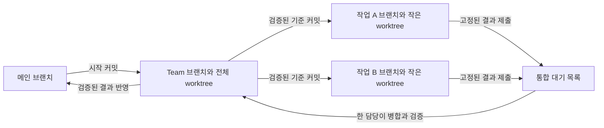

# 대화 중심의 비동기 작업 운영

Status: `partial` — 전체 실행 스케줄러와 Team worktree 운영은 `target`이며, 제안으로 표시한 절은 미결 설계다. 역할 분리, 사전 준비 기준, Lead·Team 명칭, worktree 격리, Team의 검증된 커밋에서 작업 착수, 검증까지 유지되는 단일 통합 담당은 목표 설계다. Team UI·Lead 생성과 변경 관리·관측의 소스 구현 경계는 각 절에서 구분한다. 소스 검증은 제품 전체 빌드·설치 수용이나 전체 스케줄러의 완료를 뜻하지 않는다.

## 목표 범위

사용자는 실행 세션을 직접 선택하지 않고 한 대화 세션에 요구를 누적할 수 있다. 대화 세션은 질문에 답하고 요구사항을 설계로 저장한다. 작업별로 필요한 선택이 확정되면 실행 root에 비동기로 이관한다. root는 개별 구현 작업을 직접 맡지 않고 배정, 의존성, 자원, 결과 통합과 완료 판단을 관리한다. 작업 subagent는 배정받은 범위를 실행한다.

전체 설계의 완료는 개별 작업의 착수 조건이 아니다. 기존 환경 조사처럼 재작업 부담이 작은 준비는 바로 수행할 수 있다. 설치와 프로젝트 생성은 해당 작업에 필요한 선택이 확정된 뒤 이관한다. Unity 게임이라면 기존 설치 확인과 프로젝트 생성은 서로 다른 착수 조건을 가진다.

사용자는 중심 대화 세션을 통해 작업을 할당하거나 개별 실행 세션에 직접 접근해 작업에 개입할 수 있다. 관련 세션은 하나의 묶음으로 관리하며, Work에는 묶음의 공통 설계와 작업에 관한 소통·이해를 돕는 폴더를 둔다. 물리적 위치와 기존 Work 구조와의 연결 방식은 미결이다. 이 설계 문서는 제품 계약을 소유하며, 실제 작업 기록은 프로젝트의 [Work Artifacts](../README.md#work-artifacts)를 따른다.

중심 대화 세션의 명칭은 **리드(Lead)**다. 리드는 사용자와 대화하며 요구사항과 설계를 관리하고, 실행 root는 작업 운영을 담당한다.

세션과 설계·작업 기록의 묶음 명칭은 **팀(Team)**이다. 팀은 리드, 실행 root와 작업 세션을 포함한다. 변경 범위가 한두 파일만 겹치더라도 작업별 Git worktree로 격리하고 결과를 통합한다. 리드는 착수 시 필요한 지시를 충분히 전달하며, 세션 간 반복 대화와 작업자 간 직접 조율을 최소화한다.

| 역할 | 책임 | 주로 필요한 컨텍스트 |
| --- | --- | --- |
| Lead | 사용자 대화, 요구 누적, 설계 관리와 실행 요청 발행 | 사용자 의도, 현재 설계와 미결 선택 |
| 실행 root | 작업 배정, 의존성·자원 조정, 통합 순서와 최종 판단 | 실행 요청, 작업 상태, 기준 커밋과 결과·검증 식별자 |
| 작업 세션 | 배정 범위의 준비·구현·부분 검증 | 해당 설계 부분, 공유 인터페이스, 입력과 완료 기준 |
| 통합 담당 세션 | Team 공간에서 병합, 충돌 해결과 통합 검증 | 제출 결과, 현재 Team 상태, 설계와 검증 기준 |

통합 담당은 실행 책임이며 별도의 영구 대화 세션을 필수로 요구하지 않는다. root가 한 세션에 배정하고 변경 권한을 관리한다. root는 개별 구현을 직접 수행하지 않는다. 조사·설치처럼 저장소 변경을 만들지 않는 작업은 파일 병합 없이 결과와 검증 근거를 제출한다.

역할과 요청 의미는 지원 플랫폼에 공통인 요구다. 경로, 파일 변경 제어, 설치와 프로세스 자원 제어는 플랫폼·실행 환경 경계에서 구현한다. 신규 기능의 실행 환경은 검증되지 않았다. 지원과 수용 범위는 [다중 플랫폼 계약](multi-platform.md)을 따른다.

## 제안: 팀의 경계와 공통 기록

팀의 식별자는 표시 이름과 독립적이며 세션을 재개하거나 교체해도 유지한다.

한 묶음은 공유 목표와 설계의 범위다. 저장소와 일대일로 동일시하지 않는다. 하나의 목표가 여러 저장소를 사용할 수 있고, 서로 다른 묶음이 같은 저장소를 사용할 수 있다. 따라서 쓰기 충돌과 설치·빌드 자원 조정은 묶음 경계를 넘어 실제 자원 기준으로 적용한다.

묶음의 폴더는 공통 설계, 작업별 요청·변경·결과, 관련 세션과 산출물을 연결한다. 대화 전체를 매번 모든 세션에 전달하지 않는다. 실행 요청은 필요한 설계 부분, 버전과 원문 참조를 포함한다. 상세 대화와 실행 상태의 권위 있는 저장소를 폴더에 중복 작성하는 방식은 피한다.

## 제안: 요청 전달과 직접 개입

리드의 착수 요청에는 목표, 필요한 설계 버전, 입력과 출력, 변경 범위, 공유 인터페이스, 전제와 제외 범위, 완료 기준을 담는다. root는 이 요청을 실행 가능한 배정으로 연결하고, 작업자는 고정된 요청을 기준으로 독립 실행한다. 일상적인 진행 상태와 완료는 시스템의 상태 이벤트와 결과 기록으로 수집하는 방식을 제안한다. 다른 작업자와의 대화를 정상 실행의 전제로 두지 않는다. 요구 충돌, 입력 부족, 실행 실패와 통합 불일치가 있으면 담당 root에 필요한 예외를 보고한다.

새 요청은 실행 중인 작업의 지시를 자동으로 변경하지 않고 작업 목록에 추가한다. 기존 작업의 수정·취소는 해당 작업의 식별자와 요구사항 버전에 연결한다. root는 실제 착수 여부와 변경 영향을 확인해 실행 세션에 필요한 변경분을 전달한다.

사용자는 개별 세션에서 진행 상황을 묻거나 해당 작업의 범위 안에서 실행 방법을 조정할 수 있다. 개입 내용과 작업 상태는 root가 관찰할 수 있어야 한다. 공통 설계나 다른 작업에 영향을 주는 요구 변경은 작업 세션이 기록하고 리드·root에 전달하며, 필요한 설계와 배정이 갱신된 뒤 영향받는 실행을 이어간다. 사용자를 중심 세션으로 이동시켜 같은 요청을 반복하게 하지 않는다.

설계 변경은 담당 설계 문서에 통합한다. 각 세션의 대화에만 서로 다른 요구사항을 남기지 않는다. 사용자 개입이 실행 중인 도구 호출을 이미 취소한 것으로 간주하지 않으며, 변경 적용 시점과 취소 결과를 실제 실행 상태로 확인한다.

## 변경 격리와 통합

root는 파일을 쓰는 작업에 변경 범위를 배정한다. 변경 범위가 겹치는 작업은 같은 공유 작업 폴더에 배정하지 않고 별도 worktree에서 수행한다. 겹치는 파일의 수가 적더라도 격리를 적용한다. 범위를 확장해 새로운 겹침이 생기면 실행 배정을 조정한다. 파일을 읽고 조사하거나 설계를 검토하는 작업은 동시에 진행할 수 있다.

작업자는 필요한 공유 인터페이스와 전제를 착수 요청에서 받아 독립적으로 작업한다. 격리는 동시 덮어쓰기를 줄이지만 병합 충돌이나 동작 충돌을 제거하지 않는다. root는 통합 순서를 관리하고 최종 조합을 검증한다. 통합 시 작업자끼리 반복 조율하기보다 설계와 완료 기준을 근거로 차이를 해결하며, 설계만으로 결정할 수 없는 충돌은 리드에 전달한다. 자동으로 충돌을 해결할 수 있는 범위는 미결이다.

현재 프로젝트에서 사용하는 작업 worktree의 정리는 [Worktree lifecycle](../playbooks/work.md#worktree-lifecycle)을 따른다. 제품 기능으로 유지할 Team 공간과 작업 공간의 수명 구분은 아래 메인 반영·정리 절에서 다룬다.

배정 규칙만으로 도구의 실제 쓰기를 차단할 수 있다고 주장하지 않는다. 강제 제어에는 쓰기 도구의 범위 검사 또는 격리 실행 경계가 필요하다. 실제 경로의 별칭·심볼릭 링크와 다른 묶음의 접근까지 고려해야 한다. 사용자 편집이나 관리되지 않는 프로세스의 변경은 별도로 감지하고 영향받는 작업의 기준 상태를 다시 확인한다.

설계 파일, 패키지 설정·잠금 파일, Unity 씬과 프리팹, 프로젝트 설정, 생성 디렉터리, 설치와 빌드 자원은 파일 분리만으로 안전한 병렬 실행이 보장되지 않는다. 실제 수정·실행 도구의 특성에 맞춰 파일 또는 디렉터리·프로세스 자원 단위의 배타적 담당을 둔다. 담당 세션의 종료·실패·연결 단절만으로 진행 중인 변경이 멈췄다고 간주하지 않는다.

## Team 통합 계약

Team은 전용 브랜치와 전체 프로젝트를 갖춘 통합 worktree를 가진다. 개별 작업 브랜치·worktree의 결과는 Team 공간에 순서대로 병합한다. 메인 worktree, Team worktree와 개별 작업 worktree는 같은 저장소에 연결된 별도 작업 디렉터리다. 각 공간은 별도 브랜치를 사용한다. worktree는 물리적인 부모·자식 복사 구조가 아니며, 아래 구조는 결과가 흐르는 방향이다. 근거: [Git worktree](https://git-scm.com/docs/git-worktree).

개별 작업은 root가 지정한 Team의 검증된 커밋에서 출발한다. Team 시작 시 선택한 메인 커밋을 최초 기준으로 삼되, 기존 검증 근거의 범위와 초기 환경 준비 상태를 구분한다. 검증 근거가 없으면 해당 상태를 검증 완료로 표시하지 않는다. 진행 중인 작업의 기준 커밋은 다른 작업이 병합되어도 자동으로 바꾸지 않는다. 선행 기능이 필요한 작업은 그 기능이 포함된 검증된 커밋이 준비된 뒤 착수한다.

### 제출과 상태

작업 제출은 다음 식별 정보를 갖는다. 대화 전체를 통합 담당에게 전달하는 대신 필요한 설계와 결과 기록을 참조한다.

| 정보 | 의미 |
| --- | --- |
| Team·작업 ID와 시도 ID | 작업 소속과 재시도 구분 |
| 설계 버전과 기준 커밋 | 실행에 사용한 요구사항과 코드 입력 |
| 결과 커밋 | 병합할 고정된 작업 결과 |
| 변경 범위와 선행 결과 | 배정 준수와 의존성 확인 |
| 검증 결과 | 수행 범위, 환경, 종료 코드, 로그·산출물 연결과 미검증 항목 |

제출된 결과 커밋은 고정한다. 추가 수정은 새 시도로 제출하며 제출된 결과의 식별자를 바꾸지 않는다. 미커밋 파일·추적하지 않는 파일과 외부 산출물은 Git 병합에 자동으로 포함되지 않으므로 필요한 결과를 명시적으로 보존·제출한다.

작업 상태는 준비 대기 → 실행 중 → 결과 제출 → 통합 대기 → 통합 중 → 통합 검증 → Team 반영 완료로 구분한다. 작업 세션의 실행 완료와 Team 반영 완료는 다르며, Team 반영 완료와 메인 반영 완료도 구분한다. 차단·실패·취소는 원인과 적용 시점을 기록한다. 완료된 준비 작업은 파일 통합 없이 해당 준비의 완료 기준으로 판단한다.

### 통합 잠금과 검증

Team 통합 공간에는 시스템이 관리하는 배타적 통합 권한을 둔다. 한 세션만 병합·충돌 해결·복구 등의 변경 작업을 수행한다. 잠금은 병합 시작부터 충돌 해결과 통합 검증, 결과 기록 및 안정된 상태 확인까지 유지한다. 같은 디렉터리에서 검증하는 동안 다음 병합이나 에디터 변경으로 입력이 바뀌지 않게 한다. 잠금 없이 Team 공간을 수정하는 도구 실행은 허용하지 않는 경계가 필요하다. Git의 worktree lock은 이 애플리케이션 통합 권한을 대신하지 않는다.

root는 병합 대기 목록을 관리하고 통합 작업을 한 세션에 배정한다. root 자체가 개별 구현을 맡는 방식은 아니다. 통합 세션은 충돌을 해결하고 필요한 검증을 수행한 뒤 검증된 커밋을 보고한다. 실패한 후보를 검증된 Team 상태로 표시하지 않는다. 충돌 해결·중단·복구가 끝나지 않았거나 기존 실행의 종료가 불확실하면 다음 통합을 허용하지 않는다. 통합 성공과 테스트 성공은 별개이며, 병합은 작업 결과의 미커밋 파일을 자동으로 포함하는 과정이 아니다. 근거: [Git merge](https://git-scm.com/docs/git-merge).

통합은 잠금 획득 → 제출·의존성 확인 → 현재 Team 상태 확인 → 병합·충돌 해결 → 고정된 결과 검증 → 검증된 커밋·결과 기록 → 잠금 해제 순으로 진행한다. 같은 제출이 재전달되어도 이미 반영한 결과를 중복 적용하지 않는다. 재개 시 결과 기록과 실제 브랜치·worktree 상태를 함께 확인한다.

작업 기준 커밋보다 Team이 앞서 있어도 진행 중인 작업을 모두 다시 시작하지 않는다. 통합 담당이 현재 Team과 제출 결과의 차이를 확인하고 영향받는 검증을 수행한다. 통합은 충돌 없이 끝나더라도 기능 간 동작 충돌 검증을 생략하지 않는다. 단순히 한쪽 변경 전체를 선택해 다른 요구사항을 버리는 자동 처리는 허용하지 않는다.

통합 후보와 마지막 검증된 Team 커밋은 별도로 추적한다. 통합 검증에 실패하면 후보를 실패로 남기고 마지막 검증된 기준을 유지한다. 복구 담당은 기존 실행 종료와 미커밋 변경·진행 중인 병합을 확인해 후보를 수정하거나 보존 후 안정된 상태로 복구한다. 세션 연결 단절이나 잠금 만료만으로 다음 담당에게 쓰기 권한을 넘기지 않는다. 검증된 커밋에 근거 없는 성공 상태를 붙이지 않는다.

작은 worktree에서는 가능한 부분 검증을 수행하고, 실제 파일이 필요한 테스트는 checkout 범위를 넓히거나 Team 통합 공간에서 수행한다. 테스트 도구가 sparse-checkout 외부의 파일을 자동으로 읽는다고 가정하지 않는다. Team 검증은 적용된 코드·리소스·설정과 실제 실행 환경을 고정하고, 다른 작업 세션의 변경 중인 폴더를 직접 참조하지 않는다.

별도의 고정된 snapshot에서 검증하고 후속 병합을 진행하는 최적화는 제안이다. 도입 시 후보별 검증 상태와 확정 순서를 추가로 관리해야 하며 공간·준비 비용이 늘어난다. 기본 흐름은 Team 공간에서 검증을 마친 뒤 다음 통합을 시작한다.

## Team 변경 관리

Status: `partial` — Git 기반 변경 서비스와 native local Team 도구가 소스에 구현되어 있다. 코드 내용과 이력은 Git 객체·커밋이 소유하고, 변경 서비스는 요구 버전, 변경·실행·의존성 및 검증·반영 상태를 소유한다. Work 문서는 설계·요청·결과를 연결하며 실시간 상태 원장을 중복 편집하지 않는다. 실제 검증 범위는 [작업 기록](../../work/BQ-01-team-change-management/01-plan.md)에 둔다.

논리적인 변경에는 안정된 Change ID를 부여한다. 수정·재시도·rebase로 결과가 바뀌면 불변 revision을 추가한다. revision은 저장소, 고정 base/result commit 또는 tree, 요구·설계 버전, 변경 범위, 정확한 선행 revision, 실행 시도와 제출 결과를 연결한다. 준비 조사처럼 코드 변경이 없는 작업은 실행 결과와 완료 근거로 끝낼 수 있다. 검증 기록은 대상 코드·리소스·설정, 입력·환경·명령, 실제 종료 코드, 로그·산출물과 미검증 범위를 식별한다. 통과 여부 하나로 다른 후보의 검증을 대신하지 않는다.

Lead의 요청과 개별 세션에서의 사용자 개입은 대상 Task/Change와 요구 버전에 연결한다. 실행 중인 작업의 수정은 요청된 버전과 실제 적용을 확인한 버전을 구분한다. root는 영향받는 배정과 의존 결과를 갱신한다. 정상 진행은 구조화된 상태 이벤트로 수집하고 모델에는 필요한 요약과 예외를 제공한다. 상세 대화 전체나 작업자 간 반복 조율을 정상 실행의 전제로 삼지 않는다. 변경의 적용 시점과 취소 정책은 실행 계약에서 정한다.

제출·통합 API는 재전달을 식별할 operation ID를 사용한다. Git ref 갱신과 메타데이터 저장을 하나의 원자적 transaction으로 가정하지 않는다. 통합 의도, 예상 이전 커밋, 후보와 operation ID를 먼저 보존하고 재개 시 실제 ref·worktree 상태와 대조한다. 이전 통합 담당의 뒤늦은 쓰기를 차단할 권한 세대와 실행 경계가 필요하다. 검증 실패 후보와 마지막 검증 완료 기준을 구분하며, 이미 반영된 변경의 취소는 후속 의존성을 확인한 수정·되돌림으로 처리한다. 사용자 변경을 덮어쓰는 복구를 허용하지 않는다.

### 현재 소스 경계

native host는 `team.manage_changes` 동적 도구를 Lead 생성과 등록된 local Team 재개에 제공한다. 기존 도구·요청·권한 설정을 보존하고 Team 요청에만 `features.multi_agent_v2_dynamic_tools`를 활성화해 엔진이 지원하는 자식 도구 상속을 사용한다. 호출자 ID는 native 요청에서 받고 `thread/read`의 실제 `parentThreadId`와 host별 Team registry로 소속을 확인한다. fork 관계만으로 Team 권한을 얻지 않는다. 작업 생성·요구 변경·반영 승인·잠금 복구는 등록된 Lead가 수행하며 작업자는 배정된 작업을 제출·확인한다. 별도 실행 root의 coordinator 지정은 아직 구현되지 않았다.

`scripts/team-change-service.cjs`가 Git common directory 아래 `azrael/teams/<Team ID hash>/state.json`과 전용 `refs/azrael/teams/<hash>/verified`를 관리한다. 상태 파일은 배타적 쓰기 잠금, 파일 fsync와 원자적 교체를 사용한다. Windows의 디렉터리 fsync는 별도 보장하지 않는다. operation ID와 정규화된 입력을 연결해 동일 재전달은 재사용하고 다른 내용의 재사용은 거부한다. 상태는 2 MiB, operation 기록은 1,024개로 제한하며 포화 시 새 변경을 거부해 필수 증거를 보호한다. 임의의 자동 삭제·GC는 수행하지 않는다.

제출된 base/result 커밋은 `refs/azrael/teams/<hash>/objects/<commit SHA>`로 고정한다. 작업 브랜치·worktree가 없어져도 Git GC가 제출 코드를 제거하지 않게 한다. 파일 원장만으로 Git 객체가 보존된다고 가정하지 않는다. 원장 저장 전에 고정한 ref가 저장 실패로 남으면 보호된 복구 대상으로 유지한다. Windows Git 호출은 명령별 `core.longpaths=true`를 사용해 깊은 저장소의 전용 ref 경로를 처리하며 사용자 Git 설정은 변경하지 않는다.

남은 쓰기 잠금은 시간 경과로 회수하지 않는다. `status`에 표시한 lock ID를 사용한 Lead의 `recover_write_lock`은 같은 호스트의 기록된 PID가 실제로 존재하지 않을 때만 해당 파일을 회수한다. 실행 중·확인 불가·다른 호스트·손상된 잠금과 남은 복구 guard는 보호한다. 잠금 복구는 상태·ref를 변경하지 않는 명시적 파일시스템 수리이며, 반복 시 `write_lock_absent`를 반환한다. 일반 변경 operation의 재전달 원장과 구분한다.

작업의 요구 적용 확인, 불변 revision, 정확한 선행 revision과 검증 대상을 확인한다. `begin_integration`은 현재 검증 ref와 제출 결과를 모두 포함한 후보만 예약한다. `finish_integration`은 제출된 검증 근거를 `caller_reported`로 보존하고 검토 대기로 바꾼다. Lead가 실제 근거를 검토한 뒤 `accept_integration`으로 승인해야 전용 ref가 승격된다. 필수 check ID·후보·종료 코드·범위가 맞지 않으면 승인되지 않는다. 승인 의도와 ref 갱신 사이의 중단은 실제 ref와 원장을 대조해 복구한다.

현재 서비스는 후보 생성·테스트 실행·활성 checkout 변경을 수행하지 않는다. 해당 실행은 기존 권한을 가진 도구가 담당한다. 통합 예약은 메타데이터와 전용 verified ref의 직렬화를 강제하며, 일반 shell·에디터의 Team worktree 쓰기를 차단하는 기능은 아직 없다. 따라서 ref의 승인 완료와 전체 [Team 통합 계약](#team-통합-계약)의 worktree 반영 완료를 구분한다. 메인 브랜치·원격·설치 상태를 자동 변경하지 않는다. checkpoint와 외부 Git commit의 대응, 추적하지 않는 파일·외부 산출물·LFS 보존은 후속 구현에서 구체화한다.

## 병목 관측과 개선

Status: `partial` — 단계 관측·집계와 native turn/tool/usage 수집이 소스에 구현되어 있다. 아래 관측 범위 전체의 자동 수집은 목표 계약이며 현재 자동·명시적 기록의 경계는 이 절 끝에 둔다. 측정 목적은 전체 완료 시간과 재작업을 줄일 근거를 확보하는 것이다. 에이전트 수나 동시 실행 수 자체를 성과로 삼지 않는다. 기존 [root coordination](root-coordination.md)의 실행·대기 책임을 프로그램의 상태 이벤트와 측정 자료로 지원한다.

### 관측 범위

| 구간 | 수집할 근거와 구분할 병목 |
| --- | --- |
| 요구 접수와 이관 | 접수→착수 조건 확정→root 접수 시점, 사용자 응답·선택 대기, 요구 버전 적용 확인 지연, 요구 불일치로 인한 수정·재작업 |
| 배정과 의존성 | 선행 결과 대기, 실행 가능해진 뒤 배정까지의 대기, 준비된 대기열 크기·최장 대기, 자원·권한·동시 실행 제한별 차단 원인 |
| 작업 공간 준비 | worktree·sparse 범위 준비, 실제 파일 확보, 환경 설치·리소스 import 시간과 파일 용량, 캐시 적중·대기, 저장소별 여유 공간 |
| 모델과 도구 실행 | 호출 대기·응답·도구 실행 시간, 모델·provider별 실제 제공 usage, 오류·rate limit·재시도와 원인. provider 내부 대기가 관측되지 않으면 외부 호출 시간과 분리 불가로 표시 |
| Team·메인 통합 | 통합 대기, 잠금 보유, 병합·충돌 해결·복구·검증 시간, 의존 revision 불일치와 후보 무효화. Team 반영과 메인 반영의 대기를 분리 |
| 빌드와 검증 | 자원·빌드 캐시 잠금 대기와 실제 실행 시간, 입력·환경별 재사용 여부, 중복 실행, 재검사·취소·재실행의 이유와 비용 |
| 공유 자원과 산출물 | 호스트별 CPU·메모리·디스크·네트워크의 가용한 지표, 자원 점유와 차단된 작업의 연결, worktree·Unity Library·빌드 산출물·공유 캐시의 소속별 용량 |
| 변경 서비스와 관측 자체 | 상태 저장·잠금 지연, 이벤트 전달 지연·적체·누락, 복구 대기, 수집·집계의 CPU·메모리·디스크 비용 |

대기는 원인과 차단한 후속 작업·자원 ID를 함께 기록한다. 사용자가 선택해야 하는 대기와 실행 준비가 된 작업의 스케줄링 지연을 구분한다. 의존성·자원 대기가 겹치면 같은 시간을 중복 합산하지 않고 복수 원인과 실제 실행을 막은 조건을 보존한다. 높은 사용률이나 긴 단일 실행만으로 병목을 확정하지 않는다.

### 기록과 신뢰도

단계 이벤트는 Team·Task·Change/revision·run/attempt·operation과 상위 단계 식별자를 연결한다. 준비 완료, 시작, 종료, 차단·해제, 실패·취소·재시작의 시점과 원인, 해당 입력·후보·환경 식별자를 남긴다. 성공·실패·취소·진행 중인 실행을 구분하며, 종료 기록이 없는 실행을 0초 또는 성공으로 처리하지 않는다. 재전달 이벤트는 중복 제거하고, 요구 변경에 의한 재작업과 환경·구현·검증 실패에 의한 재작업을 분리한다.

시점의 상관관계에는 UTC를, 같은 호스트의 경과 시간에는 단조 시계를 사용한다. 원격 호스트 사이의 시계 오차·측정 불가 항목을 표시하며 불확실한 타임스탬프 차이를 정확한 대기 시간으로 제시하지 않는다. OS·CPU·local/remote·도구 버전과 작업 종류·입력 규모를 비교 조건으로 남긴다. 관측 의미는 플랫폼 공통이며 OS별 자원 수집은 플랫폼 경계에서 구현·검증한다. 미지원 지표와 provider가 제공하지 않은 token 수는 0으로 채우지 않는다.

권한 있는 실행·변경 서비스가 상태 전이와 실제 프로세스 결과에서 자료를 생성한다. 모델의 수동 시간 보고나 반복 상태 조회에 의존하지 않는다. 복구·반영·필수 검증을 증명하는 최소 기록은 보존하고, 고빈도 자원 샘플과 상세 tracing은 [상세 진단 제어](diagnostic-logging.md)를 따른다. 수집 실패는 관측 불완전으로 표시하고 필수 결과 기록의 저장 실패는 반영 완료 처리를 막는다. 선택적 계측의 실패는 작업 성공·실패 판정을 바꾸지 않는다.

수집 버퍼·샘플링·저장량에 상한을 두고 적체·누락을 집계한다. 필수 상태 기록과 선택적 표본의 처리 방식을 구분한다. 프롬프트·코드 본문·비밀값을 성능 지표에 복제하지 않으며 상세 근거는 기존 권한을 가진 로그·산출물 참조로 연결한다. 원시 자료·집계 보존 기간과 용량 예산은 구현에서 정하고 [산출물 lifecycle](../playbooks/artifact-lifecycle.md)을 따른다. 활성 실행·복구·필수 검증의 근거는 일반 표본 정리에서 보호한다.

### 개선 판단

root는 대기 원인·임계 경로·재작업·관측 신뢰도를 요약해 개선 후보를 판단한다. Lead는 사용자 선택이나 요구 계약의 변경이 필요한 항목을 다룬다. 일상 이벤트마다 모델 호출·사용자 알림을 만들지 않는다. 오류·용량 부족 같은 확인된 장애와, 기준선 대비 지속적인 지연·적체를 구분한다. 지연 경보의 임계값·최소 표본 수·지속 시간은 비교 가능한 작업군의 기준선으로 조정하며 구체적인 알림 채널은 별도 UI 설계에서 정한다.

개선은 같은 작업 종류·입력 규모·환경의 기준선을 수집하고, 전체 완료 시간을 좌우하는 대기나 재작업을 찾은 뒤, 변경의 예상 효과·자원 비용·검증 영향을 제안하는 순서로 진행한다. 실행 권한 내에서 비교 실험하고 기존·변경 후 입력과 설정을 식별한다. 전체 경과 시간, 단계별 p50/p95와 표본 수, 실패·재작업률, token·자원·관측 비용을 함께 비교한다. 진행 중이거나 중단된 실행을 누락시켜 완료된 작업의 통계만 좋게 보이지 않게 한다. 겹치는 실행 시간을 더해 전체 소요 시간으로 보고하지 않는다.

통합 대기가 지배적일 때만 별도 고정 후보 검증과 짧은 승격을 후속 설계로 비교한다. 파일 확보·공간이 지배적일 때 checkout·캐시·저장 방식을 비교한다. 측정 결과만으로 잠금·필수 검증을 완화하거나 요구·실행 권한을 바꾸지 않는다. 개선 전후의 실측과 회귀 검증이 효과를 뒷받침해야 하며 추정 단축은 실측과 구분한다.

### 현재 수집 범위와 한계

`scripts/team-runtime-host.cjs`는 native turn·도구 항목의 시작·종료, 누적 token usage와 변경 API·통합 예약 전이를 수집한다. turn 시간에는 도구 시간이 포함되며 모델 응답 지연과 동일시하지 않는다. 누적 usage는 thread별 저장된 기준과의 차이만 더한다. 첫 기준값 부재·counter reset·미제공 usage는 불완전 상태로 표시한다. turn 종료 시 호스트 프로세스 메모리와 해당 파일시스템의 가용한 디스크 여유를 표본으로 남긴다. 이는 전체 호스트의 자원 사용률 계측이 아니다.

아직 연결되지 않은 준비·의존성·배정·캐시·충돌 등의 단계는 `observe`로 배정된 작업의 명시적 이벤트를 기록할 수 있으며 제출 출처를 표시한다. 자동 스케줄러·빌드 실행기와 연결되기 전에는 해당 대기의 자동 측정을 주장하지 않는다. 알 수 없는 호출 내부·원격 시계 구간의 시간을 추정해 채우지 않는다.

`scripts/team-observability.cjs`는 같은 보호 영역의 `observations/`에 선택적 표본을 보존한다. 기본 상한은 표본 2,000개·2 MiB, 대기 호출 128개, usage 기준 256개다. 종료된 표본부터 압축하고 활성 단계·필수 변경 기록을 자동 제거하지 않는다. 표본 축약·누락·저장 실패는 지속되는 불완전 표시로 남긴다. 재개 후 종료된 단계의 같은 프로세스 단조 시계 기준이 없으면 정확한 경과 시간을 제시하지 않는다.

`status`는 단계별 표본 수·p50/p95·활성 단계·대기 사유, 실패·usage와 수집 신뢰도를 제공한다. 명시적 기준선과 최소 20개 표본이 있을 때 지연 비교를 수행하며 기본 비율 기준은 1.5배다. 운영 기준선 설정·알림 UI·자동 개선 실행은 연결되지 않았다. 상태 요약과 상세 성능 비교를 구분하며 실제 작업의 성능 향상은 별도 측정이 필요하다. 선택적 표본 수집은 상태 전이 기반으로 제한하고 프롬프트·코드·도구 출력 본문을 복제하지 않는다.

요약의 `collector`는 현재 관측기 인스턴스의 호출 수·대기 시간·실제 수집 처리 시간과 최대 처리 시간을 제공한다. 같은 호스트의 다른 작업과 CPU 사용을 분리해 계측한 값은 아니며 전체 작업 시간에 합산하지 않는다. 인스턴스를 재생성하면 이 비용 계수는 초기화되고, 표본과 누락 상태는 저장소에서 이어받는다.

## 제안: 메인 반영과 정리

Team 결과를 메인 브랜치에 반영하는 단계는 개별 작업의 Team 통합과 구분한다. 반영 대상은 고정된 검증 완료 커밋이다. 여러 Team의 메인 반영은 저장소 기준으로 직렬화하고 현재 메인과의 최종 조합을 검증하는 방식을 제안한다. 언제 메인에 반영할지, 반영 뒤 Team에 메인 변경을 언제 수용할지와 자동 실행 권한은 미결이다. 메인 반영이 원격 push·게시·배포 권한을 뜻하지 않는다.

제품의 작업 worktree는 결과가 통합·검증되고 커밋·외부 산출물·필요한 증거가 보존되면 정리하는 방식을 제안한다. 실패·취소된 결과는 미보존 변경을 확인한 뒤 처리한다. Team 공간의 유지 기간과 Team 종료·보관 시 정리 기준은 미결이다. 현재 Azrael 프로젝트의 작업 worktree 완료 규칙은 기본 checkout 통합과 worktree 제거를 요구한다. 지속적인 Team 공간의 제품 lifecycle을 도입할 때 이 계약과의 관계를 정리해야 하며, 이 초안은 현재 작업 규칙의 예외를 만들지 않는다.

## 제안: 작업 공간의 크기와 실행 수

Git worktree는 이력과 객체 저장소를 공유하지만 기본 checkout은 추적 파일을 별도의 작업 디렉터리에 만든다. 추적하지 않는 기존 캐시나 빌드 산출물을 원본 폴더에서 복사하는 방식은 아니다. 작업 중 생성한 파일과 새 Git 객체는 추가 공간을 사용한다. 근거: [Git worktree](https://git-scm.com/docs/git-worktree).

코드·문서 작업에는 필요한 디렉터리와 의존 파일만 포함하는 sparse-checkout을 사용한다. 처음부터 전체 파일을 checkout하지 않도록 worktree를 생성한 뒤 작업별 범위를 설정한다. Git의 기본 cone 방식은 디렉터리와 일부 상위 파일을 포함하므로 수정한 파일만큼의 용량으로 단정하지 않는다. 근거: [Git sparse-checkout](https://git-scm.com/docs/git-sparse-checkout).

Unity 에디터 실행이 필요한 작업은 필요한 에셋과 설정을 갖춘 작업 공간에서 수행하고, 에디터 실행이 필요 없는 작업은 작은 작업 공간을 유지한다. sparse-checkout으로 생략한 에셋이 있는 상태를 전체 게임 검증 환경으로 간주하지 않는다. Unity의 Library는 로컬 캐시이며 버전 관리에서 제외한다. 에디터 실행으로 worktree별 캐시가 생길 수 있으므로 편집·검증용 동시 작업 공간 수를 자원에 맞춰 제한하는 방식을 제안한다. 근거: [Unity project directories](https://docs.unity.com/en-us/engine/6000.5/manual/get-started/project-configuration/default-directories).

Unity Accelerator 같은 공식 캐시는 반복 import 비용을 줄이는 후보이며 로컬 작업 파일과 Library의 용량이 없어지는 수단으로 보지 않는다. 필요한 Unity 버전과 실제 효과는 별도 확인한다. 근거: [Unity caching assets](https://docs.unity.com/en-us/engine/7000.0/manual/assets-and-media/importing-caching-assets).

root는 worktree와 생성 캐시·산출물의 사용량, 디스크 여유와 실행 중인 작업을 확인해 착수 수를 조절한다. 자원이 부족하면 격리를 유지한 채 착수 시점을 늦추거나 checkout 범위를 줄인다. 구체적인 예산과 확장·정리 기준은 미결이다.

## Team UI와 Lead 생성

Status: `current` in source — [작업 기록](../../work/AZ-01-team-lead-ui/01-plan.md)에 native local host 생성·재개 fixture와 Windows light/dark 렌더 검증을 기록한다. 전체 앱 빌드·설치, 실제 모델의 역할 준수와 비동기 실행은 이번 검증에 포함하지 않는다. 구현 소유자는 `scripts/inject-team-ui.cjs`와 `scripts/inject-team-runtime.cjs`이며 기능 보존 목록의 `ui.team-lead`가 소스 검사를 연결한다.

### Team 진입과 최근 채팅 표시

Team은 기존 Azrael 최근 채팅 목록에서 세션을 접고 펼칠 수 있는 그룹으로 제공한다. 그룹 안의 각 세션을 직접 열 수 있고 Lead 세션에는 **Lead** 표시를 붙인다. Team에 속하지 않은 세션의 기존 표시와 동작을 보존한다. 최근 채팅의 검색·작업공간·프로바이더·보관·페이지와 깃발 기준을 유지한다. 화면에 표시된 그룹만으로 Team 전체 세션이 모두 로드되었다고 해석하지 않는다.

이번 UI 범위의 Team 소속은 Lead와 그 native 하위 세션이다. 기존 부모·자식 식별자를 재사용하며 임의의 기존 대화를 다시 부모에 연결하지 않는다. 역할·소속 표시는 host와 실제 세션 ID를 기준으로 관리하고, 제목 문자열로 Lead를 판별하지 않는다. 새 하위 세션이 조회되면 소속을 갱신하며 역할 변경이나 실행 완료를 제목에서 추론하지 않는다.

새 채팅 버튼의 일반 클릭은 기존 새 채팅 동작이다. 우클릭 또는 길게 누르기는 Lead 생성 진입 메뉴를 연다. 메뉴를 연 조작이 일반 새 채팅 클릭까지 발생시키지 않아야 한다. 키보드로도 같은 메뉴에 접근할 수 있고, 메뉴 닫기·포커스 복귀는 기존 UI 규칙을 따른다. 화면의 배치·컴포넌트·테마 표현은 [UI presentation](ui-presentation.md)이 소유한다.

Lead 선택은 전용 생성 의도를 가진 새 채팅 초안을 열며 첫 유효한 전송 전에는 native thread를 만들지 않는다. 첫 전송의 세션 생성 단계에서 Lead 지침과 Team 소속을 연결하고, 모델 요청 전에 역할 제공과 소속 저장을 확인한다. 역할 선택 실패는 사용자에게 표시하며 일반 새 채팅으로 조용히 대체하지 않는다. 일반 새 채팅 선택은 대기 중인 Lead 생성 의도를 해제한다. 다른 세션의 전송이나 별도 webview·프로젝트의 초안에 생성 의도를 적용하지 않는다.

이번 생성 transport의 구현 대상은 native local host다. 다른 host의 역할 생성은 가용성 근거가 생기기 전까지 명시적인 실패로 처리한다. Team 식별자와 표시 설정의 host 구분은 유지한다. native 새 채팅이 별도 패널을 열면 생성 의도를 그 패널 하나에만 전달하며 공유 초안 문자열이나 모든 view의 상태에 역할을 넣지 않는다. 생성·소속 저장 실패 뒤 같은 초안의 재전송이 일반 역할로 바뀌어서는 안 된다.

### Lead 지침 제공

Lead 생성은 일반 세션과 구분되는 역할 지침을 제공한다. Design Collaboration의 사용자 의도 확인, 연결된 선택 논의와 담당 문서에 현재 설계를 유지하는 원칙을 재사용한다. Lead는 요구를 누적하며 작업별 착수 조건이 확정되면 실행 root에 필요한 설계 부분과 고정된 실행 요청을 비동기로 전달한다. 저비용 환경 조사는 바로 준비할 수 있고 설치·프로젝트 생성은 필요한 선택과 실행 권한이 갖춰져야 한다.

Lead는 개별 구현과 전체 실행 스케줄링을 직접 맡지 않는다. 사용자 대화를 계속하면서 실행 결과·판단이 필요한 예외를 설계에 반영한다. 실행 요청에는 목표, 설계 버전, 입력·출력, 전제, 범위와 완료 기준을 포함하고 작업자 사이의 반복 대화를 전제로 하지 않는다. 사용자가 새 요청을 추가하는 것과 기존 작업을 변경·취소하는 것을 구분한다. 일반 설계 세션과 작업 subagent에 Lead 역할을 자동으로 활성화하지 않는다.

지침 제공과 실제 비동기 스케줄링 도구의 가용성을 구분한다. 실행 root나 이관 도구가 없는 환경에서는 전달 내용을 준비하고 실제 접수 여부를 명확히 알리며, 작업을 보냈거나 실행이 시작되었다고 주장하지 않는다. Lead 역할은 기존 모델·권한·계정·프로젝트 지침을 변경하는 근거가 아니다.

Design Collaboration의 Lead 전용 참조는 유지되는 instruction library에 두고 일반 스킬에는 명시적인 Lead 세션에서만 읽는 조건부 경로를 둔다. 앱의 역할 제공은 해당 유지 원본을 재사용한다. Lead의 역할과 Team 소속은 재개·reload 뒤에도 복원되어야 하며, 일반 대화의 사용자 지침과 실행 권한을 덮어쓰지 않는다. Lead 지침은 모델 행동 지침이며 도구의 권한 제한이나 Team 스케줄러의 구현을 대신하지 않는다.

소스 구현은 native persisted atom의 `azrael-team-registry-v1`에 host·Lead·member ID를 저장하며 최초 생성 응답을 전달하기 전에 저장한다. cold resume은 해당 host의 기록된 Lead ID에만 유지 원본 지침을 추가한다. 새 패널 전달은 native 명령 인자와 유일한 custom editor URI를 거쳐 해당 view에만 연결한다. 역할 의도는 해당 view의 초기 동기화에 일시적으로 포함하며 영속 preference나 전체 view broadcast에 넣지 않는다. 기존 developerInstructions, 모델·프로바이더·권한 선택과 최초 전송 시 생성 흐름은 보존한다.

현재 native 자식 시작 설정은 부모 developerInstructions를 상속할 수 있다. Team registry는 자식을 Lead로 지정하지 않으며 Lead 참조도 상속만으로 역할을 얻지 않도록 명시하지만, 엔진의 지침 상속 자체나 불변 역할 격리는 이번 범위에서 구현하지 않았다. 실제 모델의 역할 준수는 별도 검증이 필요하다.

## 문서 경계와 남은 결정

실행 조정의 기존 공통 책임은 [root coordination](root-coordination.md)을 따른다. 이 문서는 사용자 접수, Team 소속, 설계·요청 전달과 Team 통합·변경 관리·병목 관측 계약을 소유한다. 지침 전달 테스트나 문서 합의는 실제 격리·잠금·복구·관측의 검증 근거가 아니다. 현재 소스 기능의 보존 연결은 [feature inventory](../../scripts/azrael-feature-contracts.json)의 `ui.team-lead`와 `ui.team-change-management`가 담당한다.

남은 결정은 Work 폴더의 위치와 기록 소유권, 실행 root의 coordinator 지정, 직접 개입의 즉시 취소·다음 시도 적용 정책, 활성 worktree 통합 잠금의 강제·복구 방식, 충돌 자동 해결 범위, 메인 반영 정책, Team 공간과 필수 변경 원장의 보관·용량 회수, 운영 기준선과 알림 방식이다. 아직 정하지 않은 항목을 구현자가 임의로 확정된 사용자 동작으로 적용하지 않는다.
